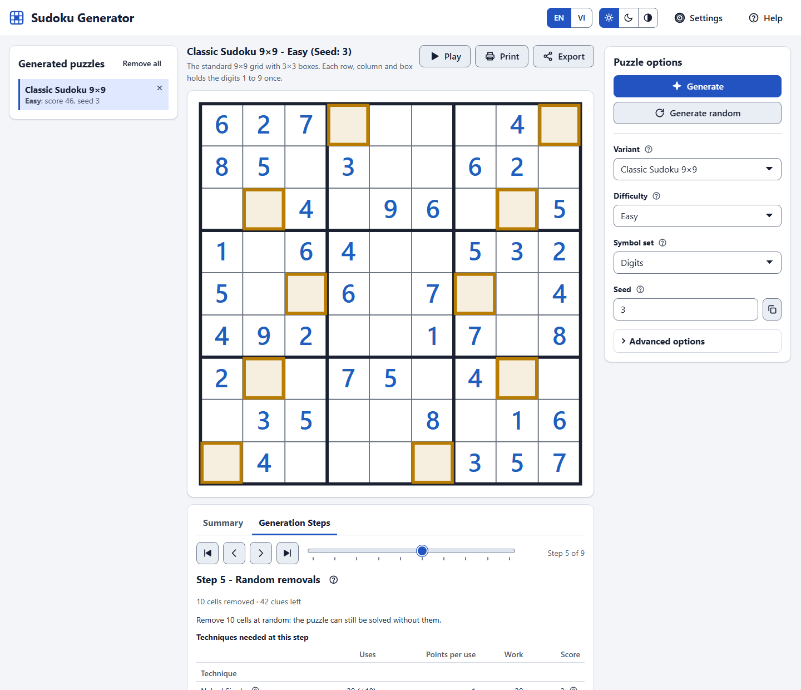
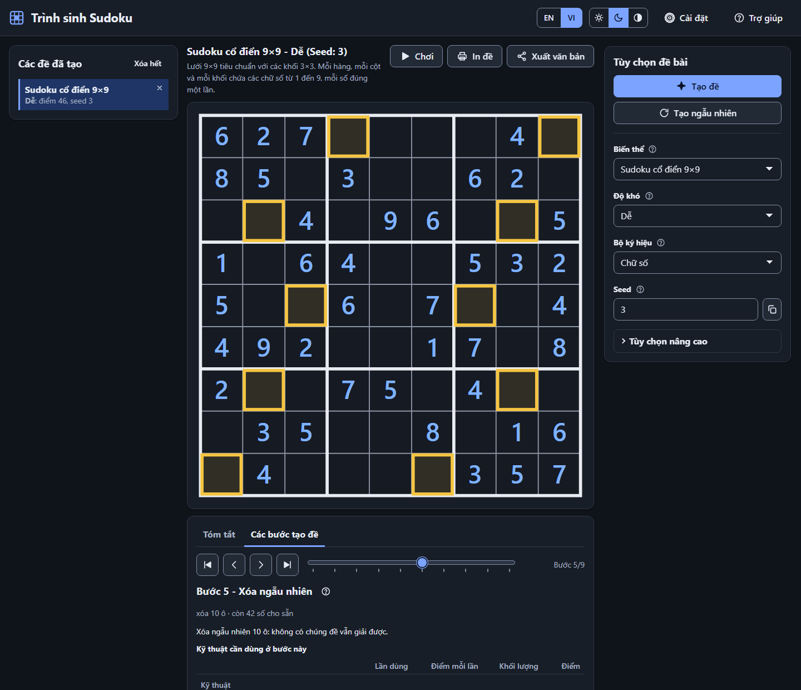
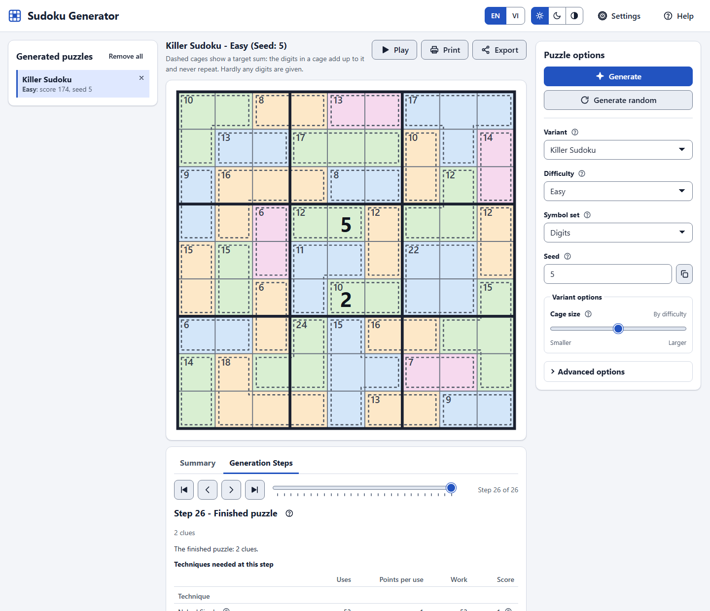

# Sudoku User Guide

**English** · [Tiếng Việt](USERGUIDE.vn.md) · [Developer guide](DEVELOPERGUIDE.md) · [README](README.md)

**Live apps:**
[Sudoku Generator](https://tdat00.github.io/sudoku/generator/) ·
[Sudoku Player](https://tdat00.github.io/sudoku/player/) ·
[GitHub](https://github.com/tdat00/sudoku)

How to use the two apps. To run them from your own copy, to understand the code or to contribute, read the
[developer guide](DEVELOPERGUIDE.md).

- [Overview](#overview)
  - [The two apps](#the-two-apps)
  - [Open the apps](#open-the-apps)
  - [Licence](#licence)
- [Sudoku Generator](#sudoku-generator)
  - [What it is](#what-it-is)
  - [Generator features](#generator-features)
  - [Screenshots](#screenshots)
  - [Running it](#running-it)
  - [URL parameters](#url-parameters)
  - [Play in Sudoku Player](#play-in-sudoku-player)
  - [Known limitations](#known-limitations)
- [Sudoku Player](#sudoku-player)
  - [How to get a puzzle](#how-to-get-a-puzzle)
  - [Player features](#player-features)
  - [Run the player](#run-the-player)
  - [Privacy](#privacy)

---

# Overview

## The two apps

| App | Live | What it does |
|---|---|---|
| **[Sudoku Generator](#sudoku-generator)** | [tdat00.github.io/sudoku/generator](https://tdat00.github.io/sudoku/generator/) | Generates puzzles of 15 variants at nine difficulty levels, replays how each puzzle was made, prints and exports them |
| **[Sudoku Player](#sudoku-player)** | [tdat00.github.io/sudoku/player](https://tdat00.github.io/sudoku/player/) | Plays a puzzle: notes, undo / redo, error checking, hints that name the technique, a timer, saved progress |

Both are in English and Vietnamese, with light, dark and high-contrast themes, keyboard and touch support. The
generator's **Play** button opens its puzzles in the player.

[Back to top](#top)

## Open the apps

You need only a web browser (Chrome or Edge 100+, Firefox 100+, Safari 15.4+); there is nothing to install and no
account. Open [Sudoku Generator](https://tdat00.github.io/sudoku/generator/) or
[Sudoku Player](https://tdat00.github.io/sudoku/player/). The apps also run from a copy on your own computer; how
to get and start one is in the [developer guide](DEVELOPERGUIDE.md#run-it-locally).

[Back to top](#top)

## Licence

Released under the [MIT licence](LICENSE) © 2026 Dat Le.

[Back to top](#top)

---

# Sudoku Generator

A web app that generates Sudoku puzzles in **15 variants**, **guarantees the difficulty you ask for**, and
**shows you how every puzzle is made** — step by step, in English or Vietnamese. It runs entirely in your browser:
no account, no server, nothing to install. To *solve* a puzzle it has made, use its sibling app
**[Sudoku Player](#sudoku-player)**: the "Play" button opens the puzzle there ([details](#play-in-sudoku-player)).

## What it is

Most Sudoku generators hand you a puzzle and nothing else. This one is also a way to *learn how puzzles are made*:

1. You pick a variant, a difficulty, optionally a seed, and press **Generate**.
2. The generator runs at full speed and **keeps a short log** of how it dug the puzzle out of a full
   solution: every clue it removed and every one it had to put back.
3. The board shows the finished puzzle at once. Then you **step through how it was made**, by hand, with the
   First / Previous / Next / Last step buttons or the slider in the **Generation steps** tab under the board. The
   tab first prepares a score table for every step (in the background, a moment after the puzzle appears), then
   shows a few steps chosen so that the score rises steadily and never goes down (the full solution, the cages
   or signs, the removals, the finished puzzle); tick **Show every move** to see every recorded change, including
   those that lowered the score. The tab describes the step that is on show, with the techniques the puzzle needs
   at that point and their score; its **Explain** icon opens the Help at that step (what, why, how, and the
   pseudocode that runs). The **Summary** tab next to it shows the difficulty of the finished puzzle and how its
   score adds up.
4. Every puzzle you generate is kept in a list on the left, so you can open it again, or print and export
   several of them together.

The difficulty is not a guess. A puzzle's score comes only from its empty cells and the solving techniques a
person needs to finish it — the hardest technique counts in full, the rest of the work on a logarithmic scale —
and the level is the score band the score falls in ([design.md](generator/design.md) §6.6). The digger only removes a clue
while the puzzle can still be solved with the techniques that fit the band of the requested level (the
*technique-bounded oracle*, [design.md](generator/design.md) §6.8), and it only returns puzzles with a complete logical
proof. The same seed with the same options always gives the same puzzle.

**Rating v2 compatibility.** "The same seed gives the same puzzle" holds within one rating/generator version.
This version changes the scoring and the generation (rating v2), so a link or a history entry made by an older
version may regenerate a different puzzle, and the scores already stored in the history are not re-rated (what
changed in the stored data is in the [developer guide](DEVELOPERGUIDE.md#cache-and-pre-generation)).

## Generator features

- **15 variants** — classic 4×4, 6×6 and 9×9; Mega 12×12 and Monster 16×16; Diagonal (X); Hyper (Windoku);
  Jigsaw; Killer; Greater-Than; Samurai, Sohei, Butterfly and Flower (overlapping grids); Wordoku.
- **Nine difficulty levels** — very easy, easy, normal, hard, expert, master, nightmare, hell 1 and
  hell 2 — scored from 21 human solving techniques (singles, locked candidates, subsets, fish, wings,
  chains) plus 3 cage and 2 inequality techniques; every variant offers the levels it reaches reliably.
- **Step-by-step replay** of the generation, moved by hand (first, previous, next and last step, or a slider
  with a notch for every step): a few steps chosen so that the score rises steadily and never goes down, or, with
  **Show every move**, every recorded change; the score tables are prepared after the puzzle appears, and the
  Help ("How it works") explains the step with pseudocode.
- **Score jumps explained** — when a step's score at least triples and rises by at least 100 points, the step
  shows a "Score jump" badge and says why: which technique the generator's solution now uses, its weight, and the
  clue (or sign) that causes the jump, framed on the board when there is exactly one. **Why?** opens the numbers
  behind the score (P, W, E, V, R, the level, the generator's recorded choice and the first deduction that uses
  the technique). A new hardest technique without a jump gets one line, the first scored step is marked "First
  rated puzzle", and in **Show every move** a board that cannot be rated says why instead of a score.
- **Difficulty score you can read** — the Summary tab lists every technique the puzzle needs with its uses,
  points and its share of the score, then the empty cells, and a Total equal to the score; the Generation steps
  tab shows the same table for every step, with the change in the Total from the step before ("551 (+507)").
- **Generated puzzles list** — every puzzle you make is saved in the browser (up to 100, newest first) and shown
  on the left as "variant" and "level: score, seed"; click one to open it again (the same seed gives the same
  puzzle within one generator version), remove one, or clear the list.
- **Bilingual interface** (English / Vietnamese), switched without a reload; every string, including the
  solving techniques and the variant rules, exists in both languages.
- **Guaranteed result** — exactly one solution (checked by a separate solver), the requested level or, when it
  cannot be reached, the closest puzzle with a clear notice.
- **Print / PDF** — the Print dialog prints the puzzles you tick in the saved list (the one on screen is ticked at
  first), 1, 2 or 4 to a page (4 at first), optionally with their solutions on pages of their own; choose "Save as PDF" in the print dialog to get a PDF file (vector graphics, so the lines stay sharp).
- **Text export** — the **Export** button next to **Print** shows the puzzles you tick in the saved list as readable text (`#1,Classic Sudoku 9x9,Hard,<seed>` then one grid row per line, `.` for empty cells) with a Copy
  button, to copy into a file or another tool.
- **Play in Sudoku Player** — the **Play** button next to **Print** hands every puzzle of the saved list, with the
  one on screen first, to the separate [Sudoku Player](#sudoku-player)
  web app, where you solve them with notes, undo/redo, checking, hints that name the technique and a timer. The
  puzzles travel inside the link (after the `#`), compressed, so nothing is uploaded; see
  [Play in Sudoku Player](#play-in-sudoku-player).
- **Accessible** — keyboard navigation, ARIA grid, live announcements, light, dark and high-contrast themes,
  adjustable text size, reduced motion.
- **In-app help** — the rules of all 15 variants, the technique ladder and keyboard shortcuts.
- **Static and offline** — the generator itself never sends anything anywhere. Recently generated puzzles are
  cached in the browser, and the next one is quietly pre-generated in the background, so *Generate* is often
  instant.

The variants (`id` is the value of the URL parameter `v`):

| `id` | Variant | Digits | Cells | Levels offered |
|------|---------|-------:|------:|----------------|
| `classic4` | Classic Sudoku 4×4 | 4 | 16 | veryEasy |
| `classic6` | Classic Sudoku 6×6 | 6 | 36 | veryEasy, hard |
| `classic9` | Classic Sudoku 9×9 | 9 | 81 | veryEasy–hell1 |
| `mega12` | Mega Sudoku 12×12 | 12 | 144 | veryEasy–hell2 |
| `mega16` | Monster Sudoku 16×16 | 16 | 256 | veryEasy–hell2 |
| `diagonalX` | Diagonal Sudoku (X) | 9 | 81 | veryEasy–hell2 |
| `hyper` | Hyper Sudoku (Windoku) | 9 | 81 | veryEasy–hell2 |
| `jigsaw9` | Jigsaw Sudoku | 9 | 81 | veryEasy–hell2 |
| `killer` | Killer Sudoku | 9 | 81 | veryEasy–hell2 |
| `greaterThan` | Greater-Than Sudoku | 9 | 81 | veryEasy–hell2 |
| `samurai` | Samurai Sudoku | 9 | 369 | veryEasy–hell2 |
| `sohei` | Sohei Sudoku | 9 | 288 | veryEasy–hell2 |
| `butterfly` | Butterfly Sudoku | 9 | 144 | veryEasy–hell2 |
| `flower` | Flower Sudoku | 9 | 189 | veryEasy–hell2 |
| `wordoku` | Wordoku | 9 | 81 | veryEasy–hell1 |

## Screenshots

Replaying the generation of a Classic 9×9 puzzle (light theme, English):

The same page in the dark theme and in Vietnamese:

A Killer puzzle with its cages:

## Running it

You need only a web browser (Chrome or Edge 100+, Firefox 100+, Safari 15.4+). The live app is at
**[tdat00.github.io/sudoku/generator](https://tdat00.github.io/sudoku/generator/)**. A copy opened straight from
your disk works too, but less smoothly (see [Known limitations](#known-limitations)); how to run a copy, or to
publish your own, is in the [developer guide](DEVELOPERGUIDE.md#running-the-generator-locally).

Open the **Help** button for the rules of every variant, the technique ladder and the keyboard shortcuts.

## URL parameters

The address bar always holds the state of the page, so a link reproduces a puzzle exactly. Only values that
differ from the defaults are written. The page has no share-link button: copy the address, and a link that
carries a seed reproduces the puzzle. Any other parameter is ignored, the `trace` and `speed` of older links
included.

| Parameter | Example | Meaning |
|-----------|---------|---------|
| `v` | `v=jigsaw9` | Variant id (the table above). Default `classic9`. |
| `d` | `d=hard` | Difficulty: `veryEasy`, `easy`, `normal`, `hard`, `expert`, `master`, `nightmare`, `hell1`, `hell2`; a level the variant does not offer becomes the nearest one it offers. Default `normal`. |
| `seed` | `seed=1734567890` | Seed. A whole number 0–4294967295 is used as it is; any other text is hashed to one. Missing = random. A link (or a reload) with a seed generates that puzzle as soon as the page loads. |
| `sym` | `sym=mirrorH` | Symmetry of the given cells: `none`, `rotational180` (default), `rotational90`, `mirrorH`, `mirrorV`, `mirrorBoth`, `diagonal`, `antiDiagonal`. |
| `mode` | `mode=letters` | Symbol set: `digits`, `letters`, `colors`, `shapes`, `word` (Wordoku only). Default: the variant's own. |
| `order` | `order=snake` | Order in which clues are tried: `random` (default), `rowByRow`, `snake`, `spiral`, `jumpOne`. |
| `attempts` | `attempts=12` | Full grids to try before settling for the closest puzzle, 1–20. Default 8. |
| `sol` | `sol=1` | Show the solution next to the puzzle. |
| `o.<id>` | `o.cageSize=2` | An option of the chosen variant, for example `o.compactness=0.8` (jigsaw9), `o.futoshiki=1` (greaterThan), `o.placement=row` (wordoku). |
| `lang` | `lang=vi` | Language: `en` or `vi`. Default: the stored choice, then the browser language. |
| `auto` | `auto=1` | Generate as soon as the page loads (a link with a `seed` does so anyway). |

`?v=classic9&d=master&seed=42&lang=vi&auto=1` always gives the same puzzle. Settings are also kept in the
browser's `localStorage`, never sent anywhere: `sg.prefs.v1` (language, theme, text size, reduced motion, the
colour-blind symbol), `sg.lastConfig.v1` (the last options), `sg.cache.v1` (up to 20 recently generated puzzles,
so that the same puzzle opens at once), `sg.history.v1` (the list of generated puzzles on the left, up to 100). A
link that names a puzzle parameter wins over the stored options. If storage is blocked, the page keeps everything
in memory for the session.

## Play in Sudoku Player

The generator only **generates** puzzles. Solving them is the job of its sibling,
**[Sudoku Player](#sudoku-player)** (published at
[tdat00.github.io/sudoku/player](https://tdat00.github.io/sudoku/player/)): a separate app with a grid you can fill in, candidate notes,
undo/redo, error checking, hints that name the logical technique, a timer, progress saved per puzzle, all 15
variants, English / Vietnamese, themes and accessibility.

**How the puzzles get there.** Press the **Play** button next to **Print** in the main panel. The page takes
**every puzzle of the saved list** (and the puzzle on screen, if it is not in the list), writes them as the
readable text of the **Export** box, packs that text into one token and opens the player (next to the generator
on the same site) in a new tab, at `…/player/index.html#puzzle=<token>&active=<n>`. `active` is the number of the
puzzle that was on screen: the player puts exactly that one on its board and lists all the others. Puzzles that
are not at hand are generated again from their seed first (a small dialog shows the progress and ends with an
**Open the player** button). The token is in the URL **fragment** (after the `#`), which a browser never sends to
a server, so nothing is uploaded. Because it is compressed text, a hundred puzzles fit in a link of a few tens of
kB; when the link is longer than about 100 kB a toast warns that some apps and servers cut long links.

The format of the link, and how to point the button at another copy of the player, are in the
[developer guide](DEVELOPERGUIDE.md#the-exchange-format).

## Known limitations

- **Opened from a file** (`file://`), the generator is less smooth: browsers do not allow it to work in the
  background there, so it works in small slices on the page itself. The page stays responsive between slices but
  may pause for a moment on a large board (up to a few hundred milliseconds), **Cancel** takes effect at the next
  slice, and the next puzzle is not pre-generated in the background. The live site, or a copy served by a web
  server ([developer guide](DEVELOPERGUIDE.md#running-the-generator-locally)), does not have this problem.
  The score tables of the **Generation steps** tab are also calculated on the page there: the tab waits for you
  to press **Prepare score tables**, and the page may stop responding briefly while it works; the finished puzzle
  and the Summary tab are usable before that.
- **No real screen-reader run.** Keyboard operation, ARIA roles and live announcements are implemented and
  checked in a headless browser, but no one has listened to them with a screen reader yet.
- **The difficulty is an estimate**: the weights of the techniques and the score bands of the levels were chosen
  from measurements of generated puzzles, not from tests with human solvers
  ([details](DEVELOPERGUIDE.md#known-technical-limitations)). A combination that is hard to reach (a strict
  symmetry with a very high level) returns the closest puzzle with a notice instead of the exact level.
- **Not every level is offered everywhere**: Classic 4×4 offers only very easy and Classic 6×6 very easy and hard;
  Classic 9×9 and Wordoku stop at hell 1; every other variant offers all nine levels. The levels a variant
  offers are the ones it passed in the qualification ([docs/difficulty-rating/qualification.md](docs/difficulty-rating/qualification.md)).
- **The hardest levels are the slowest**: the slowest combinations are Greater-Than and Killer from expert
  upwards and the hell levels of the large boards, with a 95th percentile of up to about 9.5 s (Greater-Than
  expert; Killer expert and nightmare 8–9 s; Monster 16×16 and Samurai hell 2 6–7 s) and single requests up to
  about 13 s; most other combinations take well under a second.
- **Wordoku in Vietnamese**: nine-letter words with nine different letters are rare in Vietnamese, so the
  list is short; when it is too short the English list is used and a notice says so.
- **Settings**: the switch that turns background pre-generation off is not remembered between visits.
- **Not built**: a minimap or horizontal scrolling for Monster 16×16 on phones (the board scales to the
  screen width instead), and a "warm start" that digs a harder puzzle from an easier one.
- **Browsers**: developed and checked in Chromium-based Edge only; Firefox 100+ and Safari 15.4+ are the
  supported targets but have not been tried, and neither has a real phone.
- **The Play button** needs a browser that does not block pop-ups for the page, and the player next to the
  generator (as on the live site). A link longer than about 100 kB (a very long list of puzzles) may be cut by
  chat apps and servers and then does not open every puzzle in the player.

[Back to top](#top)

---

# Sudoku Player

**Sudoku Player** is a small web app that opens a Sudoku puzzle made by
[Sudoku Generator](https://tdat00.github.io/sudoku/generator/) and lets you **play** it online: notes, exact undo
and redo, error checking, hints that name the logical technique they use, a timer, and progress that is saved
for you. English and Vietnamese, light / dark / high-contrast themes, keyboard and touch, no server, no
account, nothing to install. **Open it: [tdat00.github.io/sudoku/player](https://tdat00.github.io/sudoku/player/).**

## How to get a puzzle

1. In Sudoku Generator press **Play** (at the top right of the generator's main panel): its link opens here with
   **every puzzle of the generator's list** in the address (`#puzzle=<token>&active=<n>`: their text, compressed
   and URL-safe), which is read in your browser and then removed from the address bar. All the puzzles go into
   the list on the left, and the one that was on screen in the generator opens first.
2. Or press **Import** and paste the text of Sudoku Generator's **Export** box (one or many puzzles, up to 200
   in one text, of any variant — a header line `#1,variant,level,seed`, the grid, and for Jigsaw, Killer, Greater-Than and Wordoku a
   few lines that describe the board); you can also drop a text file (up to 8 MB) anywhere on the page. Every puzzle that can
   be rebuilt goes into the list on the left and the first one opens; one that cannot (for example a text from an
   older generator without those lines) is listed as skipped. A link (`…#puzzle=<token>`) or one line of 81
   (9×9), 36 (6×6) or 16 (4×4) characters where `.`, `0`, `-` and `_` mean an empty cell also work. The
   **Share** button (before Import) gives the link of the puzzle on the board.
3. Or pick one of the **imported puzzles** on the left (a faded icon marks a solved one and one in progress; the
   list keeps its order while you play); a reload brings back the puzzle you were playing.

[Back to top](#top)

## Player features

- **All 15 variants** are playable: Classic 4×4, 6×6 and 9×9, Mega 12×12, Monster 16×16, Diagonal (X), Hyper
  (Windoku), Jigsaw, Killer, Greater-Than, Samurai, Sohei, Butterfly, Flower and Wordoku.
- Imported difficulty names cover **Very easy, Easy, Normal, Hard, Expert, Master, Nightmare, Hell 1 and
  Hell 2**, in English and Vietnamese. Puzzles from older versions of the generator still open, but their old
  level ids (`medium`, `veryHard`, `evil`, `nightmare1`, `nightmare2`) are not translated: such a puzzle opens
  with an unknown difficulty (no level in its title). A puzzle keeps its saved progress when only its rating
  changes.
- Select by mouse, touch or keyboard (arrow keys, Home / End, Page Up / Down); type a symbol or use the
  on-screen number pad; notes (`N`); erase; undo / redo (`Ctrl+Z`, `Ctrl+Y`).
- Error checking: off, rule conflicts (repeats, cage sums, signs) or every wrong entry as you type.
- **Hints** in three steps (the technique and where to look, the cells, the move) that are always correct and
  name one of 26 techniques, with a translated name and description.
- Symbol modes: digits, letters, colours (always with a shape), shapes and the Wordoku word; a solved Wordoku
  shows its key word and, when the built-in word book knows the word, its meaning.
- A timer that pauses when you leave the tab, completion detection and reveal-a-cell.
- **Saved progress** per puzzle (the last 100 puzzles) and the last 100 imported puzzles; opening the same puzzle
  again offers *Continue* or *Start over*.
- A summary above the puzzle (variant, level, seed and the description of the variant), and a status box with
  **Play / Pause / Resume** and **Reset** (it appears only while the game is paused or solved), the time and the filled cells,
  separate for every puzzle: leaving a running game pauses it.
- An **Options** frame (closed at first) with the symbols, the check mode and the notes behaviour. The play frame
  (tools and pad) expands to show the actions on the puzzle (fill in all notes, reveal a cell, which asks for a
  second press), hidden at first, right under the pad. Clicking a cell also pops up the
  keys next to it; on a small screen the tools and the pad are fixed to the bottom and the buttons are icons.
- Settings (language, theme, text size, reduced motion, colour symbol, check mode, notes behaviour,
  coordinates), and a **guide** (`help.html`, opened by the Help button in a new tab): the basics of playing, how
  the hints work, the techniques that solve harder puzzles with a real example for each of the 26, and the
  keyboard shortcuts.
- Accessible: skip link, an ARIA grid with spoken cell labels, live announcements, focus kept in dialogs,
  contrast checked from the design tokens, forced-colours and reduced-motion support.

[Back to top](#top)

## Run the player

There is nothing to install: open
**[tdat00.github.io/sudoku/player](https://tdat00.github.io/sudoku/player/)**. Add `?lang=vi` to the address for
Vietnamese (the guide too: `help.html?lang=vi`; `help.html#tech-xWing` opens one technique).

The puzzle link looks like `…/index.html#puzzle=<token>` (with `&active=<n>` for a list of puzzles). The token is
compressed and URL-safe, and the part after the `#` never leaves the browser. A text file or a pasted line works
without any token. To run the player from a copy on your computer, see the
[developer guide](DEVELOPERGUIDE.md#run-the-player-locally).

[Back to top](#top)

## Privacy

Everything runs in your browser; nothing is uploaded, there are no accounts, trackers or cookies. Only these
items are kept in the local storage of the browser (the Remove all button of the list of puzzles deletes the
puzzles and the progress):

| Key | What |
|-----|------|
| `sg.player.prefs.v1` | language, theme, text size and the other settings |
| `sg.player.progress.v1` | your progress on the last 100 puzzles |
| `sg.player.puzzles.v1` | the last 100 puzzles you imported |
| `sg.player.last.v1` | the puzzle that was on the board |

If the browser blocks storage, the player says so and keeps your game in memory until you close the tab.

[Back to top](#top)
