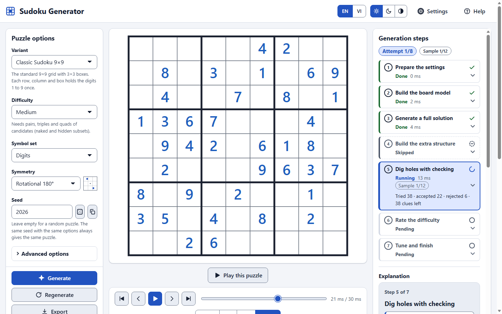
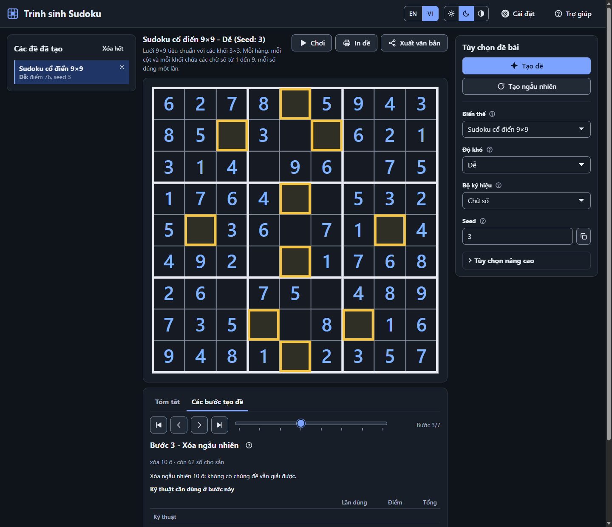
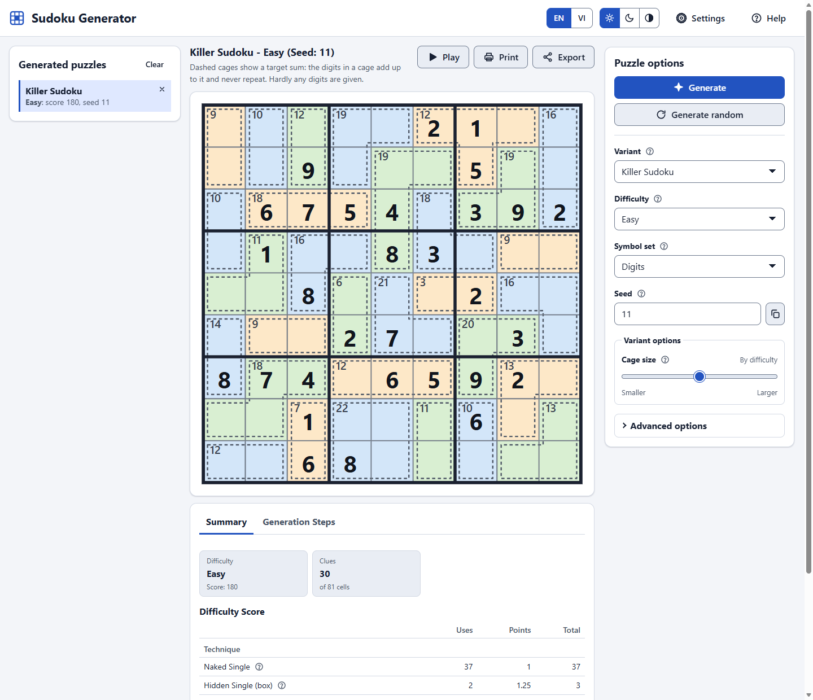

# Sudoku Generator

<a id="top"></a>

**Live apps · Ứng dụng trực tuyến:**
[Sudoku Generator](https://tdat00.github.io/sudoku-generator/) ([GitHub](https://github.com/tdat00/sudoku-generator)) ·
[Sudoku Player](https://tdat00.github.io/sudoku-player/) ([GitHub](https://github.com/tdat00/sudoku-player))

- [Table of Contents](#english)
  - [What it is](#what-it-is)
  - [Features](#features)
  - [Screenshots](#screenshots)
  - [Running it](#running-it)
  - [URL parameters](#url-parameters)
  - [Play online](#play-online-with-sudoku-player)
  - [How it works](#how-it-works)
  - [Adding a variant](#adding-a-variant)
  - [Adding a technique](#adding-a-technique)
  - [Running the tests](#running-the-tests)
  - [Conventions](#conventions)
  - [Known limitations](#known-limitations)
  - [Licence and credits](#licence-and-credits)
- [Mục lục](#tieng-viet)
  - [Giới thiệu](#giới-thiệu)
  - [Tính năng](#tính-năng)
  - [Ảnh chụp màn hình](#ảnh-chụp-màn-hình)
  - [Cách chạy](#cách-chạy)
  - [Tham số URL](#tham-số-url)
  - [Chơi trực tuyến](#chơi-trực-tuyến-với-sudoku-player)
  - [Cách hoạt động](#cách-hoạt-động)
  - [Thêm một biến thể](#thêm-một-biến-thể)
  - [Thêm một kỹ thuật](#thêm-một-kỹ-thuật)
  - [Chạy kiểm thử](#chạy-kiểm-thử)
  - [Quy ước](#quy-ước)
  - [Hạn chế đã biết](#hạn-chế-đã-biết)
  - [Giấy phép và ghi công](#giấy-phép-và-ghi-công)

---

A static web app, written in plain HTML, CSS and JavaScript, that generates Sudoku puzzles in **15 variants**,
**guarantees the difficulty you ask for**, and **shows you how every puzzle is made** — step by step, in
English or Vietnamese. No framework, no build step, no server, no external library. To *solve* a puzzle it has
made, use its sibling app **[sudoku-player](https://github.com/tdat00/sudoku-player)**: the "Play" button
opens the puzzle there ([details](#play-online-with-sudoku-player)).

Một ứng dụng web tĩnh viết bằng HTML, CSS và JavaScript thuần, tạo đề Sudoku cho **15 biến thể**, **đảm bảo
đúng độ khó bạn chọn** và **cho bạn xem từng bước đề được tạo ra** — bằng tiếng Anh hoặc tiếng Việt. Không
framework, không bước biên dịch, không máy chủ, không thư viện ngoài. Muốn *giải* một đề vừa tạo, hãy dùng ứng
dụng anh em **[sudoku-player](https://github.com/tdat00/sudoku-player)**: nút "Chơi" mở đề đó ở bên
ấy ([chi tiết](#chơi-trực-tuyến-với-sudoku-player)). (Phần tiếng Việt nằm ở [phía dưới](#tieng-viet).)



---

<a id="english"></a>

# English

## What it is

Most Sudoku generators hand you a puzzle and nothing else. This one is also a way to *learn how puzzles are made*:

1. You pick a variant, a difficulty, optionally a seed, and press **Generate**.
2. The generator runs at full speed and **keeps a short log** of how it dug the puzzle out of a full
   solution: every clue it removed and every one it had to put back.
3. The board shows the finished puzzle at once. Then you **step through how it was made**, by hand, with the
   First / Previous / Next / Last step buttons or the slider in the **Generation Steps** tab under the board: each
   step is one change you can see (the full solution, the cages or signs, a batch of removals, the finished
   puzzle). The tab describes the step that is on show, with the techniques the puzzle needs at that point and
   their score; its **Explain** icon opens the Help at that step (what, why, how, and the pseudocode that runs).
   The **Summary** tab next to it shows the difficulty of the finished puzzle and how its score adds up.
4. Every puzzle you generate is kept in a list on the left, so you can open it again, or print and export
   several of them together.

The difficulty is not a guess. A puzzle's score comes only from its empty cells and the solving techniques a
person needs to finish it — the hardest technique counts in full, the rest of the work on a logarithmic scale —
and the level is the score band the score falls in ([design.md](design.md) §6.6). The digger only removes a clue
while the puzzle can still be solved with the techniques that fit the band of the requested level (the
*technique-bounded oracle*, [design.md](design.md) §6.8), and it only returns puzzles with a complete logical
proof. The same seed with the same options always gives the same puzzle.

**Rating v2 compatibility.** "The same seed gives the same puzzle" holds within one rating/generator version.
This version changes the scoring and the generation (rating v2), so a link or a history entry made by an older
version may regenerate a different puzzle; the scores already stored in the history are not re-rated; the result
cache drops the puzzles an older version stored, once; and an export keeps the `sudoku-generator/v1` format and
gains `difficulty.ratingVersion: 2`.

## Features

- **15 variants** — classic 4×4, 6×6 and 9×9; Mega 12×12 and Monster 16×16; Diagonal (X); Hyper (Windoku);
  Jigsaw; Killer; Greater-Than; Samurai, Sohei, Butterfly and Flower (overlapping grids); Wordoku.
- **Nine difficulty levels** — very easy, easy, medium, hard, very hard, expert, evil, nightmare 1 and
  nightmare 2 — scored from 21 human solving techniques (singles, locked candidates, subsets, fish, wings,
  chains) plus 3 cage and 2 inequality techniques; every variant offers the levels it reaches reliably.
- **Step-by-step replay** of the generation, moved by hand (first, previous, next and last step, or a slider
  with a notch for every step): each step is one visible change of the board, the easy early removals are
  summed up in batches, and the Help ("How it works") explains the step with pseudocode.
- **Difficulty score you can read** — the Summary tab lists every technique the puzzle needs with its uses,
  points and its share of the score, then the empty cells, and a Total equal to the score; the Generation Steps
  tab shows the same table for the puzzle at each step.
- **Generated puzzles list** — every puzzle you make is saved in the browser (up to 100, newest first) and shown
  on the left as "variant" and "level: score, seed"; click one to open it again (the same seed gives the same
  puzzle within one generator version), remove one, or clear the list.
- **Bilingual interface** (English / Vietnamese), switched without a reload; every string, including the
  solving techniques and the variant rules, exists in both languages.
- **Guaranteed result** — exactly one solution (checked by a separate solver), the requested level or, when it
  cannot be reached, the closest puzzle with a clear notice.
- **Print / PDF** — the Print dialog prints the puzzles you tick in the saved list (the one on screen is ticked at
  first), 1, 2 or 4 to a page (4 at first), optionally with their solutions on pages of their own; choose "Save as PDF" in the print dialog to get a PDF file (vector graphics, so the lines stay sharp).
- **Text export** — the **Export** button next to **Print** shows the puzzles you tick in the saved list as readable text (`#1,Classic Sudoku 9x9,Hard,<seed>` then one grid row per line, `.` for empty cells) with a Copy
  button, to copy into a file or another tool.
- **Play online** — the **Play** button next to **Print** hands every puzzle of the saved list, with the one on
  screen first, to the separate [sudoku-player](https://github.com/tdat00/sudoku-player)
  web app, where you solve them with notes, undo/redo, checking, hints that name the technique and a timer. The
  puzzles travel inside the link (after the `#`), compressed, so nothing is uploaded; see
  [Play online with sudoku-player](#play-online-with-sudoku-player).
- **Accessible** — keyboard navigation, ARIA grid, live announcements, light, dark and high-contrast themes,
  adjustable text size, reduced motion.
- **In-app help** — the rules of all 15 variants, the technique ladder and keyboard shortcuts.
- **Static and offline** — open `index.html`, or serve the folder with any static server; the generator itself
  never sends anything anywhere. Recently generated puzzles are cached in the browser, and the next one is
  quietly pre-generated in the background, so *Generate* is often instant.

The variants (`id` is what the URL parameter `v` and the code use):

| `id` | Variant | Digits | Cells | Levels offered |
|------|---------|-------:|------:|----------------|
| `classic4` | Mini Sudoku 4×4 | 4 | 16 | veryEasy |
| `classic6` | Mini Sudoku 6×6 | 6 | 36 | veryEasy, hard |
| `classic9` | Classic Sudoku 9×9 | 9 | 81 | veryEasy–nightmare1 |
| `mega12` | Mega Sudoku 12×12 | 12 | 144 | veryEasy–nightmare2 |
| `mega16` | Monster Sudoku 16×16 | 16 | 256 | veryEasy–nightmare2 |
| `diagonalX` | Diagonal Sudoku (X) | 9 | 81 | veryEasy–nightmare2 |
| `hyper` | Hyper Sudoku (Windoku) | 9 | 81 | veryEasy–nightmare2 |
| `jigsaw9` | Jigsaw Sudoku | 9 | 81 | veryEasy–nightmare2 |
| `killer` | Killer Sudoku | 9 | 81 | veryEasy–nightmare2 |
| `greaterThan` | Greater-Than Sudoku | 9 | 81 | veryEasy–nightmare2 |
| `samurai` | Samurai Sudoku | 9 | 369 | veryEasy–nightmare2 |
| `sohei` | Sohei Sudoku | 9 | 288 | veryEasy–nightmare2 |
| `butterfly` | Butterfly Sudoku | 9 | 144 | veryEasy–nightmare2 |
| `flower` | Flower Sudoku | 9 | 189 | veryEasy–nightmare2 |
| `wordoku` | Wordoku | 9 | 81 | veryEasy–nightmare1 |

## Screenshots

Replaying the generation of a Classic 9×9 puzzle (light theme, English):


The same page in the dark theme and in Vietnamese:



A Killer puzzle with its cages:



## Running it

You need only a web browser (Chrome or Edge 100+, Firefox 100+, Safari 15.4+).

**The quickest way** — open `index.html` in the browser (double-click it, or drag it onto a window). It works
from `file://`, but browsers do not allow Web Workers there, so the generator runs on the main thread in small
slices: the page stays responsive between slices but may pause
for a moment on a large board (one unsplittable piece of work can take up to a few hundred milliseconds),
**Cancel** takes effect at the next slice, and the background pre-generation of the next puzzle is off.

**Recommended** — serve the folder with any static server. Then the generator runs in a Web Worker, the page stays smooth, **Cancel** works at once and the next puzzle is quietly
pre-generated while you look at this one:

```bash
cd sudoku-generator
python -m http.server 8000      # then open http://localhost:8000/
# or:  npx serve .
```

**GitHub Pages** — the app uses only relative paths, so it works from any sub-path with no configuration.
Choose *Settings → Pages → Build and deployment → Source → GitHub Actions*. The
[deployment workflow](.github/workflows/pages.yml) runs the Node 24 tests and publishes the app after every
push to `main`; you can also run it manually from the **Actions** tab. Only the app files and licence are
published, not the tests or working notes. The live app is at
**[tdat00.github.io/sudoku-generator](https://tdat00.github.io/sudoku-generator/)**.

Open the **Help** button for the rules of every variant, the technique ladder and the keyboard shortcuts.

## URL parameters

The address bar always holds the state of the page, so a link reproduces a puzzle exactly. Only values that
differ from the defaults are written. The page has no share-link button; a link that carries a seed reproduces the puzzle (`SG.store.shareUrl` builds one that also carries `v d sym mode`). Any other parameter is ignored, the `trace` and `speed` of older links included.

| Parameter | Example | Meaning |
|-----------|---------|---------|
| `v` | `v=jigsaw9` | Variant id (the table above). Default `classic9`. |
| `d` | `d=hard` | Difficulty: `veryEasy`, `easy`, `medium`, `hard`, `veryHard`, `expert`, `evil`, `nightmare1`, `nightmare2`; a level the variant does not offer becomes the nearest one it offers. Default `medium`. |
| `seed` | `seed=1734567890` | Seed. A whole number 0–4294967295 is used as it is; any other text is hashed to one. Missing = random. A link (or a reload) with a seed generates that puzzle as soon as the page loads. |
| `sym` | `sym=mirrorH` | Symmetry of the given cells: `none`, `rotational180` (default), `rotational90`, `mirrorH`, `mirrorV`, `mirrorBoth`, `diagonal`, `antiDiagonal`. |
| `mode` | `mode=letters` | Symbol set: `digits`, `letters`, `colors`, `shapes`, `word` (Wordoku only). Default: the variant's own. |
| `order` | `order=snake` | Order in which clues are tried: `random` (default), `rowByRow`, `snake`, `spiral`, `jumpOne`. |
| `attempts` | `attempts=12` | Full grids to try before settling for the closest puzzle, 1–20. Default 8. |
| `sol` | `sol=1` | Show the solution next to the puzzle. |
| `o.<id>` | `o.cageSize=2` | An option of the chosen variant, for example `o.compactness=0.8` (jigsaw9), `o.futoshiki=1` (greaterThan), `o.placement=row` (wordoku). |
| `lang` | `lang=vi` | Language: `en` or `vi`. Default: the stored choice, then the browser language. |
| `auto` | `auto=1` | Generate as soon as the page loads (a link with a `seed` does so anyway). |

`?v=classic9&d=expert&seed=42&lang=vi&auto=1` always gives the same puzzle. Settings are also kept in the
browser's `localStorage`: `sg.prefs.v1` (language, theme, text size, reduced motion, the colour-blind
symbol), `sg.lastConfig.v1` (the last options), `sg.cache.v1` (up to 20 recently generated puzzles, see
[Cache and pre-generation](#cache-and-pre-generation)), `sg.history.v1` (the list of generated puzzles on the left, up to 100). A link that names
a puzzle parameter wins over the stored options. If storage is blocked, the
page keeps everything in memory for the session.

## Play online with sudoku-player

This repository only **generates** puzzles. Solving them is the job of its sibling,
**[sudoku-player](https://github.com/tdat00/sudoku-player)** (published at
[tdat00.github.io/sudoku-player](https://tdat00.github.io/sudoku-player/)): a separate static app with a grid you can fill in, candidate notes,
undo/redo, error checking, hints that name the logical technique, a timer, progress saved per puzzle, all 15
variants, English / Vietnamese, themes and accessibility.

**How the puzzles get there.** Press the **Play** button next to **Print** in the main panel. The page takes
**every puzzle of the saved list** (and the puzzle on screen, if it is not in the list), writes them as the
readable text of the **Export** box, packs that text into one token and opens
`https://tdat00.github.io/sudoku-player/#puzzle=<token>&active=<n>` in a new tab (`window.open(url, '_blank',
'noopener')`). `active` is the number of the puzzle that was on screen: the player puts exactly that one on its
board and lists all the others. Puzzles that are not at hand are generated again from their seed first (a small
dialog shows the progress and ends with an **Open the player** button). The token is in the URL **fragment**,
which a browser never sends to a server, so nothing is uploaded. Because it is compressed text, not documents,
a hundred puzzles fit in a link of a few tens of kB; when the link is longer than about 100 kB a toast warns
that some apps and servers cut long links. The player's address comes from
`<meta name="sg-player-url" content="https://tdat00.github.io/sudoku-player/">` in `index.html`: change it to
point at your own copy.

**The exchange format** — the only coupling between the two repositories, implemented by `js/ui/exchange.js`
(`SG.exchange`, the same file byte for byte in both, with the suite `tests/suites/exchange.test.js`):

- A **bundle** (the Play button) is the text of `SG.exportUi.buildExportText`: per puzzle a header line
  `#<n>,<variant>,<level>,<seed>`, the grid and, for Jigsaw, Killer, Greater-Than and Wordoku, a few structure
  lines. The player rebuilds the boards from it, exactly as it does for text pasted into its Import box.
- Its **text token** is `t.` + base64url(deflate-raw(UTF-8 text)) — or `s.` + base64url(text) when compression is
  not available or does not pay. `SG.exchange.encodeText(text)` and `SG.exchange.decodeText(token)` are
  asynchronous; `SG.exchange.playerUrl(base, token, { active })` builds the link (`&active=<n>`, 1-based) and
  `SG.exchange.activeFromHash(hash)` reads it back.
- The **document** of a single puzzle (still understood by the player, and what its Share button writes) is the
  puzzle JSON of [design.md](design.md) §14.1 (`format: 'sudoku-generator/v1'`), as
  `SG.exportUi.toJson` writes it, plus one additive block, **`model`**: the plain-data model specification
  (`variantId`, `digits`, `units`, `unitMeta`, `cages`, `inequalities`, `layout`, `symbols`, `fixedCells`) that
  `SG.model.create(spec)` accepts. With it the player rebuilds the board **without any variant code**. Its token
  is `z.` + base64url(deflate-raw(JSON)) — or `j.` + base64url(JSON); `SG.exchange.encode(doc)` and
  `SG.exchange.decode(token)` are asynchronous.
- `SG.exchange.playerUrl(base, token)` refuses a base that is not `http(s)` or a relative
  path. Failures carry the codes `exchange.invalidToken`, `exchange.tooLarge`, `exchange.unsupportedEncoding`,
  `exchange.invalidJson` and `exchange.invalidUrl`, translated in both languages (`error.exchange.*`).
- In code: `SG.exportUi.buildPlayBundle(results, { active })` is the link of several puzzles
  (`{ url, token, base, count, active, length, long }`), `SG.exportUi.toJson(result)` the document and
  `SG.exportUi.buildPlayLink(result)` the link of one puzzle, `SG.exportUi.openPlayLink(url)` opens it. Details:
  [design.md](design.md) §10.9 and §13.15.

## How it works

### Layers

```
┌──────────────────────────────────────────────────────────────────────────────────────────────┐
│ UI            js/ui/        app · controls · board-view (SVG) · step-view · explain · player  │
│                             · result-view · i18n · store · export · exchange · a11y …         │
├──────────────────────────────────────────────────────────────────────────────────────────────┤
│ ORCHESTRATION js/worker/    worker-client (Web Worker, or the main-thread fallback)           │
│                             gen.worker.js (runs the pipeline off the main thread)             │
├──────────────────────────────────────────────────────────────────────────────────────────────┤
│ GENERATION    js/core/      pipeline · full-grid · digger · symmetry · difficulty · events    │
├──────────────────────────────────────────────────────────────────────────────────────────────┤
│ SOLVER        js/core/      dfs-solver · logical-solver · techniques + tech-*.js              │
├──────────────────────────────────────────────────────────────────────────────────────────────┤
│ MODEL         js/core/ and js/variants/    model · constraints · bits · rng · 15 variants     │
└──────────────────────────────────────────────────────────────────────────────────────────────┘
```

A lower layer never knows about a higher one. `js/core/` and `js/variants/` never touch the DOM, which is what
lets the whole engine run in Node for the tests.

**One model for every variant.** A puzzle is a set of cells, a list of *units* (groups of cells that must hold
different values: rows, columns, boxes, jigsaw regions, diagonals, windows, cages) and optional extras (cage
sums, inequalities). Samurai and friends are just a bigger model whose grids share cell indices. So one
solver and one generator serve all 15 variants, and `js/core/` has no `if (variant === …)` anywhere:
differences go through the registry (`SG.variants`).

### The generation pipeline and its event stream

`SG.pipeline.run(config, emit, budget)` is synchronous and always goes through seven steps:
`configure → buildModel → fullGrid → extraStructure → dig → rate → tune`. It returns a `PuzzleResult`
(`model, givens, solution, rating, seed, config, timings, attempts, warnings, digLog`) and reports
everything through `emit` as `GenerationEvent`s:
`{ type, stepId, phase, t, seq, i18nKey?, i18nArgs?, patch?, metrics? }`. A `patch` is a *delta* of at most
eight cells (`{ cells: [{ i, value, state }], highlight, unhighlight }`), never a snapshot.
`SG.events.VOCABULARY` is the contract for every event key.

`dig`, `rate` and `tune` are three steps that repeat per *dig sample*: when the puzzle that was just dug misses
the requested level (`tune.miss`), the next sample is dug from the same grid (up to 12 per grid); when none of
them hits, a local search starts from the closest one (it adds, removes or swaps symmetric groups of clues), and
only then does `retry.difficulty` start a new grid (up to `attempts`, default 8). The top levels (evil and the
nightmares) also dig fast, uniqueness-only proposals and put clues back while a proposal is too hard. Every grid
has fixed work caps (full ratings and proposed moves, counted, never timed), so a seed gives the same puzzle on
every machine. If every attempt is used, the closest puzzle is returned with a notice instead of an error (only
a puzzle with a complete logical proof is ever returned). `SG.pipeline.runSteps` is the same algorithm as a
generator that yields at natural boundaries (what the worker and the main-thread mode run), and
`SG.pipeline.toWire` / `fromWire` carry a result across `postMessage`. The difficulty of a puzzle is
`SG.difficulty.rate(...)`, from the technique weights `SG.difficulty.WEIGHTS`; use `rating.score`, never the
solver's raw score.

The UI never slows the algorithm down to animate it, and its replay does not read the events. Next to them
the digger keeps a compact **dig log** of the sample that became the puzzle (`result.digLog`: entries `pass`,
`accept`, `reject`, `keep` and `restart`, plus `signs`, `clear`, `reveal` and sign verdicts for Greater-Than;
the header of `js/core/digger.js` describes them). It is the same whatever the trace verbosity, the thread or
the board size, and `toWire` / `fromWire` carry it. After a run the board shows the finished puzzle at once;
nothing plays by itself. `SG.player.buildSteps(result)` (pure) turns the log into the steps of the replay,
each one a change the board shows: the full solution; the cages (Killer) or the signs (Greater-Than); batches
of random removals, about a ninth of the board tried per step, with the removed cells framed and the cells
that had to go back framed dashed red; rounds of the guided dig, each taking the removal that makes the
puzzle hardest; for Greater-Than the batches of signs taken away and the clues shown when the puzzle came out
too hard; and the finished puzzle. The technical work (settings, board model, rating, tuning, samples that
missed the level) is not shown. A Classic 9×9 *easy* puzzle with seed 3, for example, replays in 7 steps: the
full solution, five batches of random removals (9, 10, 10 and 10 cells, then "8 cells removed · 2 cells put
back") and the finished puzzle with 34 clues. `SG.player.create()` is the manual player (first, previous,
next, last, seek; position 0 is the empty grid), `SG.stepView.create()` the description of the step on show
(with a legend of the board frames and the techniques the puzzle needs at that step). The explanation
of the seven steps lives in the Help dialog (tab "How it works"): one collapsible entry per step with its
what / why / how and pseudocode, `SG.explainCard.create(el, { compact: true })`; the entry of the replay step on
show is marked, open, and its running line and dig counters are shown (`SG.app.getExplainContext()`). The
**Explain** (help) icon of the step description opens the Help on that tab. Overlays (cages, signs, windows) are drawn from
the model of the result, not from the log.
Random choices use forked streams of one seeded generator (`SG.rng`), which is why a seed reproduces a
puzzle.

### Worker and fallback

`SG.workerClient.generate(config, onEvent)` returns a promise of the `PuzzleResult`; `.cancel()` stops a run,
`.mode` tells `'worker'` or `'main'`, `.ready()` settles once the mode is known, and `SG.workerClient.create()`
makes an independent client (with `dispose()`) for the cache. Over `http(s)` the client
starts `js/worker/gen.worker.js`, which loads the core, the variants and the word lists with `importScripts`
and runs `SG.pipeline.runSteps` in slices of about 12 ms, so a `cancel` message is read between slices: the
promise is rejected at once, the work stops at the next boundary, and a worker that does not answer within
150 ms is terminated (and created again when it is needed). Where a Worker cannot start (`file://`, a restrictive policy) the client
falls back to the main thread and runs the same slices there. The puzzle for a given
seed is identical in both modes.

### Cache and pre-generation

`SG.cache` (`js/ui/cache.js`) stores every generated puzzle in `localStorage` (`sg.cache.v1`, 20 puzzles,
least recently used out first, schema version checked), so the same configuration with the same seed is served
at once. It stores the puzzle only, never the trace nor the dig log: a cached puzzle is shown immediately (the
replay waits, with a "preparing the replay" note) and is **generated again from its seed in the background**;
its dig log then gives it its replay (`SG.app.attachTrace(trace, digLog)`), which opens on the finished
puzzle — the regenerated puzzle must equal the cached one, otherwise the entry is dropped. When the page has
been idle for a second, the cache also pre-generates one or two puzzles with the same options in a worker,
which "Generate" (with an empty seed) and "Generate random" then hand out instantly. It never runs while a
generation is in progress, pauses in a hidden tab, skips configurations that are slow, and does not exist in
main-thread mode. A switch in Settings turns the pre-generation off (the choice is not remembered).

### Puzzle history

`SG.history` (`js/ui/history.js`) adds every puzzle the page generates to a list kept in `localStorage`
(`sg.history.v1`, newest first, 100 entries at most; with no storage the list lives in memory). An entry is small:
variant, level asked for and reached, seed, clues, score, time and the configuration that rebuilds the puzzle
(`SG.history.entryOf(result)`); an imported puzzle is not listed because no seed rebuilds it. The list is the
left panel of the page (`#history-root`; under the result on narrower screens). A puzzle that is generated again
moves to the top; picking an entry writes its configuration to the form and generates it (the same seed gives
the same puzzle within one generator version, and the cache serves it at once when it still has it) without
moving it; an entry made before rating v2 may regenerate a different puzzle, and its stored level and score are
not re-rated. Each entry can be removed, and **Clear** empties the list.

### Internationalisation

`SG.i18n.t(key, args)` translates `{placeholders}`; `data-i18n` and `data-i18n-attr` attributes translate the
HTML. The two base packs are plain scripts (`js/ui/locale.en.js`, `locale.vi.js`), never fetched JSON, so
`file://` works. Every other module — including `js/ui/locale.shell.js`, the strings of the static page frame —
keeps its own strings in a **fragment** pushed at the bottom of its file, which `SG.i18n` merges into the packs
(a key that a base pack already defines wins, and the clash is reported):

```js
SG.localeFragments = SG.localeFragments || [];
SG.localeFragments.push({
  en: { 'variant.disjoint9': 'Disjoint Groups Sudoku' },
  vi: { 'variant.disjoint9': 'Sudoku Nhóm rời' }
});
```

Rules, enforced by `tests/suites/i18n.test.js`: both languages have the same keys, no value is empty, the
`{placeholders}` match, keys are unique, and the Vietnamese is real Vietnamese (an established term such as
*X-Wing*, *Jigsaw* or *seed* stays as it is). Never build a sentence from several keys: word order differs.

### One namespace, no modules, one script order

Every file is an IIFE that attaches to a single global, `SG`; there is no `import`, `export` or `require` in
`js/`, so the same file runs as a classic `<script>`, inside a Worker through `importScripts`, and in Node
through `vm.runInThisContext`:

```js
(function (root) {
  'use strict';
  const SG = root.SG = root.SG || {};
  // ... definitions ...
  SG.something = { /* ... */ };
})(typeof self !== 'undefined' ? self : globalThis);
```

Because there are no imports, **load order is the dependency graph**. `SOURCE_FILES` in
`tests/node-runner.js` is the single source of truth; the same order is repeated in `index.html` (`<script>`
tags), in the `SOURCE_FILES` array of `tests.html`, and — for the core, the variants and the word lists only,
never the UI — in `js/worker/gen.worker.js`. `tests/suites/ui-contract.test.js` fails when they drift apart.
**Adding a JavaScript file means adding it to all four places.** Files that do not exist yet are skipped by
the runner and `tests.html`.

### The UI modules

`js/ui/app.js` owns the page and exposes `SG.app`: `getStore()`, `getBoard()`, `getPlayer()`, `getStepView()`,
`getResult()` (the last `{ result, trace }`), `generate()`, `regenerate()`, `cancel()`, `showResult()` (show a
puzzle that was not generated on this page), `toast()`, `announce()`, `openModal()`,
`setClient()` and `attachTrace()` (what the cache uses), and an event bus `on()` / `emit()` with the events
`generate:start`, `generate:progress`, `generate:end`, `generate:error`, `generate:cancel`, `result`, `trace`
(`{ result, trace }`, once `attachTrace()` gave a cached puzzle its replay), `position` (`{ position, length,
step, direction }` after every move of the replay; `step` is a step of `SG.player.buildSteps`, null at
position 0), `locale`, `theme`, `settings` and `action`. The header of `app.js` is the full contract.

**Adding a UI module without editing `app.js`.** At the end of start-up `app.js` calls `init(SG.app)` — which
must be idempotent — on each of these optional modules that exists, in this order, every call in its own
`try/catch`:

| Module | What it does |
|--------|--------------|
| `SG.exportUi` | The Print dialog (print / PDF of the puzzles chosen from the saved list, 1, 2 or 4 per page, optionally with the solutions on their own pages), the **Export** button (`action { id: 'exportCode' }`: the chosen puzzles as readable text, `buildExportText(items)`) and the **Play** button (`action { id: 'play' }`: opens the puzzle in sudoku-player, see above) |
| `SG.a11y` | The board as an ARIA grid with keyboard navigation, live announcements (a generation starts, the language changes), the Settings dialog |
| `SG.theme` | Light, dark and high-contrast themes (and "auto"), the hints of the empty / busy / error states |
| `SG.help` | The Help dialog (rules, technique ladder, shortcuts) |
| `SG.cache` | The cache and pre-generation described above; it replaces the generation client with a wrapper |
| `SG.history` | The list of generated puzzles (`localStorage` key `sg.history.v1`, newest first, 100 at most) shown in the left panel; picking one writes its configuration to the form and generates it again |

Such a module listens with `SG.app.on('action', …)` (the Print and Play buttons of the main panel and the
Settings and Help buttons of the header emit `action { id: 'export' | 'exportCode' | 'play' | 'settings' | 'help' }`), draws
dialogs with `SG.app.openModal()` and reads the puzzle with `SG.app.getResult()`; a name that
is not in the list needs one more entry in the `OPTIONAL_MODULES` list of `app.js`. Every UI file must **load
in Node without a DOM** (top-level code only defines functions and pushes locale fragments; the DOM is touched
inside functions called at run time), and keeps its logic in pure, testable functions next to the DOM code.
`js/ui/exchange.js` (`SG.exchange`) is not one of these modules: it is a DOM-free helper that `exportUi` uses
and that sudoku-player shares byte for byte.

### Directory tree

```
sudoku-generator/
├── index.html              the page: every <script> tag, in dependency order; the sg-player-url meta tag
├── tests.html              the same test suites, run in the browser
├── design.md · task.md     the design specification (as built) and the task list with its completion summary
├── README.md · LICENSE     this file · the MIT licence
├── docs/                   screenshots used by this README · report-v1.md (the final QA report of version 1) ·
│                           report-v2/ (rating v2: brief and detailed reports, qualification.md = the levels
│                           each variant offers, the researchers' reports)
├── assets/
│   ├── favicon.svg         the inline favicon
│   ├── wordlists/          isograms.en.js · isograms.vi.js   key words of Wordoku
│   └── wordbook/           words.en.js · words.vi.js   spelling, part of speech and meaning of each key word
├── css/
│   ├── tokens.css          colours (3 themes), spacing, motion: the only place for colour literals
│   ├── tokens-board.css    colours of the board (3 themes)
│   ├── base.css · layout.css · components.css · board.css · steps.css
│   ├── help.css · print.css
├── js/
│   ├── core/               engine, no DOM
│   │   ├── ns.js · errors.js · bits.js · budget.js · rng.js
│   │   ├── model.js · constraints.js · combo-table.js         model and propagation
│   │   ├── dfs-solver.js · logical-solver.js · techniques.js  solvers and the technique registry
│   │   ├── tech-basic.js · tech-subset.js · tech-fish.js · tech-wing.js · tech-chain.js
│   │   ├── tech-cage.js · tech-ineq.js                        Killer and Greater-Than techniques
│   │   ├── difficulty.js · full-grid.js · symmetry.js · digger.js
│   │   └── events.js · explain-data.js · pipeline.js          the seven steps and their events
│   ├── variants/           registry.js · classic.js · mega.js · extra-regions.js · jigsaw.js · killer.js
│   │                       · greater-than.js · multigrid.js · wordoku.js
│   ├── worker/             gen.worker.js · worker-client.js
│   └── ui/                 exchange.js (link to sudoku-player) · i18n.js · locale.en.js · locale.vi.js
│                           · locale.shell.js · symbols.js · board-view.js · store.js · controls.js
│                           · step-view.js · explain.js · player.js (replay of the generation)
│                           · result-view.js · wordbook.js (meaning of a key word) · cache.js · history.js
│                           · export.js · a11y.js · theme.js · help.js · app.js
└── tests/
    ├── harness.js · node-runner.js · soak.js · perf.js · qualify.js
    ├── fixtures/           puzzles and fixtures with known answers, the performance helper and the
    │                       regression hashes (regression.js, generated)
    └── suites/             one *.test.js per area, 43 in all (found automatically)
```

## Adding a variant

A variant is **data plus a `build` function** that registers itself; no other file needs to know about it. The
rules are in [design.md](design.md) §5.3. Here is a complete, working example — *Disjoint Groups Sudoku*: the
classic rules plus nine extra groups, each made of the cells that sit at the same place in their box. It needs
no new solver code, because a group is just one more unit.

**1. Write `js/variants/disjoint.js`:**

```js
// js/variants/disjoint.js
(function (root) {
  'use strict';

  const SG = root.SG = root.SG || {};

  const SIZE = 9;
  const BOX = 3;

  /** Row-major indices of the cells whose row and column pass `test`. */
  function cellsWhere(test) {
    const cells = [];
    for (let r = 0; r < SIZE; r++) {
      for (let c = 0; c < SIZE; c++) if (test(r, c)) cells.push(r * SIZE + c);
    }
    return cells;
  }

  /** Classic units, then the nine "disjoint groups": same row and column inside the box. */
  function build() {
    const units = [];
    const unitMeta = [];
    function addUnit(kind, label, cells) {
      units.push(cells);
      unitMeta.push({ kind: kind, gridIndex: 0, label: label });
    }
    for (let k = 0; k < SIZE; k++) {
      addUnit('row', 'R' + (k + 1), cellsWhere(function (r) { return r === k; }));
    }
    for (let k = 0; k < SIZE; k++) {
      addUnit('col', 'C' + (k + 1), cellsWhere(function (r, c) { return c === k; }));
    }
    for (let k = 0; k < SIZE; k++) {
      addUnit('box', 'B' + (k + 1), cellsWhere(function (r, c) {
        return Math.floor(r / BOX) * BOX + Math.floor(c / BOX) === k;
      }));
    }
    for (let k = 0; k < SIZE; k++) {
      addUnit('region', 'G' + (k + 1), cellsWhere(function (r, c) {
        return (r % BOX) * BOX + (c % BOX) === k;
      }));
    }
    const n = SIZE * SIZE;
    const cellRow = new Int32Array(n);
    const cellCol = new Int32Array(n);
    const cellRegion = new Int32Array(n);
    for (let i = 0; i < n; i++) {
      cellRow[i] = Math.floor(i / SIZE);
      cellCol[i] = i % SIZE;
      cellRegion[i] = Math.floor(cellRow[i] / BOX) * BOX + Math.floor(cellCol[i] / BOX);
    }
    return SG.model.create({
      variantId: 'disjoint9',
      digits: SIZE,
      units: units,
      unitMeta: unitMeta,
      layout: {
        rows: SIZE, cols: SIZE, cellRow: cellRow, cellCol: cellCol, cellRegion: cellRegion,
        subGrids: [{ gridIndex: 0, originRow: 0, originCol: 0 }]
      }
    });
  }

  SG.variants.register({
    id: 'disjoint9',
    i18nKey: 'variant.disjoint9',
    group: 'extraRegions',                  // 'group.<id>' must exist in the locale packs
    digits: SIZE,
    difficultySupport: ['veryEasy', 'easy', 'medium', 'hard'],
    defaultSymbolMode: 'digits',
    symbolModes: ['digits', 'letters', 'colors', 'shapes'],
    options: [],
    build: build
  });

  SG.localeFragments = SG.localeFragments || [];
  SG.localeFragments.push({
    en: {
      'variant.disjoint9': 'Disjoint Groups Sudoku',
      'variant.disjoint9.desc': 'Classic rules, and the cells at the same place in each box must also differ.'
    },
    vi: {
      'variant.disjoint9': 'Sudoku Nhóm rời',
      'variant.disjoint9.desc': 'Luật cổ điển, và các ô ở cùng vị trí trong mỗi khối cũng phải khác nhau.'
    }
  });
})(typeof self !== 'undefined' ? self : globalThis);
```

What the definition passed to `SG.variants.register(def)` can hold (`js/variants/registry.js` validates it, so
a typo fails when the file loads, not in the middle of a run):

| Field | Meaning |
|-------|---------|
| `id`, `i18nKey`, `group`, `digits` | Unique id; translation key of the name; family used to group variants in the UI (`group.<group>` key); number of values D (up to 16). |
| `difficultySupport` | Levels the variant offers, a subset of `veryEasy … nightmare2` (gaps are allowed): exactly the levels that pass the qualification of `node tests/qualify.js --variant=<id>` ([docs/report-v2/qualification.md](docs/report-v2/qualification.md)). |
| `defaultSymbolMode`, `symbolModes` | Symbol sets the UI may offer (`digits`, `letters`, `colors`, `shapes`, `word`). |
| `options` | Variant options for the UI (`slider`, `select`, `boolean`, `text`). Declare labels with `i18nKey` and help with `hintKey`; `SG.variants.optionsOf(id)` gives them in one normalised shape, and the controls are built from it. |
| `build(opts, rng)` | Returns the `PuzzleModel`; only for geometry and units. |
| `clueFloor`, `clueFloorScale` | Optional own minimum number of clues per level, in place of the classic9 numbers scaled by `cellCount / 81` (see "Clue floor per variant" in `js/core/difficulty.js`). Use them when the generic floor makes a level unreachable. |
| `postGenerate(ctx)`, `digStrategy`, `fastSeed`, `restartThreshold` | Optional pipeline hooks: structure made from the finished solution (Killer cages, Greater-Than signs; models are immutable, so it returns a new model), an alternative digging strategy (registered with `SG.digger.registerStrategy` and named here), a pre-fill and a restart threshold of the full-grid search. |

**2. Load the file — add its path to all four script lists**, anywhere after `js/variants/registry.js` (next to
the other variants is natural): `index.html` (a `<script>` tag), `tests.html` (`SOURCE_FILES`),
`tests/node-runner.js` (`SOURCE_FILES`) and `js/worker/gen.worker.js` (`SCRIPTS`, with a path relative to
`js/worker/`). `ui-contract.test.js` checks that the four agree.

**3. Tests you get for free.** `tests/suites/variants.test.js` loops over `SG.variants.list()`, so the new
variant is covered without editing any test: CV0 the definition, CV1 every model passes
`SG.model.validate`, CV2 full grids, CV3 a puzzle at every declared level (and the other levels are
refused), CV4 the invariants I1–I7 of [design.md](design.md) §15.3 (one solution, givens ⊂ solution, …; I6 uses the
variant's own clue floor), CV5 the same seed gives the same puzzle, CV6 no generation hangs, CV7 the names,
option labels and level names exist in both languages. Write an
extra suite (`tests/suites/disjoint.test.js`, and add its name to `SUITE_FILES` in `tests.html`) only for
logic of your own.

**4. Add its help entry.** The in-app Help must explain every variant. In `js/ui/help.js` add the id to
`VARIANT_HELP` (`{ figure: 'board' }` draws the empty board automatically) and add the three texts
`help.variant.disjoint9.rules`, `.special` and `.figure` to the fragment at the bottom of the file, in both
languages. `tests/suites/help.test.js` fails until you do, and also fails when README.md does not mention the
new id: add a row to the table above.

**5. Qualify its levels.** `node tests/qualify.js --variant=disjoint9` generates 40 puzzles per level with fixed
seeds and offers a level when at least 36 hit it exactly within the time budget (30–35 hits: 60 more seeds, at
least 90 of the 100); put the levels it prints into `difficultySupport` and its table into
[docs/report-v2/qualification.md](docs/report-v2/qualification.md). `node tests/soak.js --variant=disjoint9` then shows
how often each requested level is hit, the invariant violations and the time per puzzle. A level that misses
can be helped by a `clueFloorScale`; otherwise it stays hidden.

## Adding a technique

A solving technique is one function that finds *one deduction* in the current candidates. It lives in its
own `tech-*.js` file and registers itself, so the solver and the digger never change. The full contract is the
header of `js/core/techniques.js`. A complete example — *Full House*, a unit with a single open cell:

```js
// js/core/tech-fullhouse.js
(function (root) {
  'use strict';

  const SG = root.SG = root.SG || {};

  /** Full House: in a complete unit with exactly one open cell, that cell takes the missing digit. */
  function findFullHouse(model, state, ctx) {
    for (let u = 0; u < model.units.length; u++) {
      if (ctx.completeUnits[u] !== 1) continue;           // a digit must appear exactly once in it
      const cells = model.units[u];
      let open = -1;
      let openCount = 0;
      let used = 0;
      for (let i = 0; i < cells.length; i++) {
        const value = state.value[cells[i]];
        if (value === 0) {
          open = cells[i];
          openCount++;
        } else {
          used |= 1 << (value - 1);
        }
      }
      if (openCount !== 1) continue;
      const missing = ctx.fullMask & ~used;               // one bit: the digit the unit still lacks
      if ((missing & (missing - 1)) !== 0 || (state.candidates[open] & missing) === 0) continue;
      const digit = 32 - Math.clz32(missing);
      return {
        technique: 'fullHouse',                           // must equal the registered id
        cells: [open],
        placements: [[open, digit]],
        eliminations: [],
        i18nKey: 'technique.fullHouse.step',
        i18nArgs: { cell: SG.model.cellLabel(model, open), unit: model.unitMeta[u].label, digit: digit }
      };
    }
    return null;                                          // does not apply
  }

  SG.techniques.register({
    id: 'fullHouse',
    group: 'basic',               // one of SG.techniques.GROUPS: the family the Help lists it under
    baseCost: 1,                  // the solver's own raw score; the rating uses SG.difficulty.WEIGHTS
    order: 5,                     // loop position in the fixed priority order, lower first (nakedSingle is 10)
    i18nKey: 'technique.fullHouse',
    variantScope: null,           // null = every variant; ['killer'] = only models of that variant
    assumesUniqueness: false,     // true ONLY when the deduction needs "the puzzle has one solution"
    find: findFullHouse
  });

  SG.localeFragments = SG.localeFragments || [];
  SG.localeFragments.push({
    en: {
      'technique.fullHouse': 'Full House',
      'technique.fullHouse.desc': 'When a row, column or box has one empty cell left, it holds the missing digit.',
      'technique.fullHouse.step': '{unit} has only one empty cell left, {cell}. It must hold {digit}.'
    },
    vi: {
      'technique.fullHouse': 'Full House',
      'technique.fullHouse.desc': 'Khi một hàng, cột hoặc khối chỉ còn một ô trống, ô đó chứa chữ số còn thiếu.',
      'technique.fullHouse.step': '{unit} chỉ còn một ô trống là {cell}. Ô này phải là {digit}.'
    }
  });
})(typeof self !== 'undefined' ? self : globalThis);
```

1. **Rules of `find`**: read `state`, never write to it (the solver applies the finding, which keeps the
   scoring honest); return `null` when nothing applies, otherwise exactly one deduction that really changes
   the state; no randomness; work on any unit shape through `model.units` (never assume rows and boxes); call
   `ctx.check()` in long loops.
2. **Load it** by adding the file next to the other `tech-*.js` files in the four script lists of
   [How it works](#how-it-works).
3. **Strings**: `technique.<id>` (name), `technique.<id>.desc` and `technique.<id>.step` in both languages;
   `tests/suites/i18n.test.js` checks that every registered technique and every step text has them. The Help
   dialog's technique ladder lists the new technique by itself.
4. **Weight and level**: add the technique's weight to `WEIGHTS` in `js/core/difficulty.js`
   (`SG.difficulty.WEIGHTS`; a rating that meets a technique without a weight fails with
   `difficulty.unknownTechnique` — a weight is never guessed from `baseCost`). The score of a puzzle is
   `round(80·E/(E+40) + P + 0.25·P·log₂(1 + W/P))`, where `E` is the number of empty cells, `P` the largest weight
   used and `W` the sum of weight × uses, and the weight alone decides where the technique is allowed: the oracle
   of a level allows every technique whose 1.25 × weight is below the level's band maximum, so a weight of 400
   makes it available from *hard* on (500 is below hard's maximum, 700, not below medium's, 400). The `group`
   only names its family (`cage` and `ineq` belong to Killer and Greater-Than). Then re-run the qualification,
   `node tests/qualify.js`, and check the hit rates with `node tests/soak.js --quick`.
5. **Tests**: add positive and negative fixtures and the soundness check to the matching
   `tests/suites/tech-<group>.test.js` (helpers in `tests/fixtures/techniques-helper.js`): a technique must
   never eliminate a value that belongs to the true solution.

## Running the tests

Everything runs in Node 18+ with no installation (no npm packages are used):

```bash
node tests/node-runner.js                          # every suite (43, about 3,500 tests), about eight minutes
node tests/node-runner.js --suite=killer,variants  # only these suites (file name without .test.js)
node tests/node-runner.js --filter=xWing --verbose # only tests whose name contains the text
node tests/node-runner.js --bail                   # stop at the first failure
```

The runner loads `SOURCE_FILES` with `vm.runInThisContext`, discovers `tests/fixtures/*.js` and
`tests/suites/*.test.js` by itself, and exits with a code other than 0 on any failure. The suites cover the
engine, every variant, the solving techniques, the pipeline and its events, the worker and its client, and the
pure parts of every UI module (they run without a DOM). `tests/suites/help.test.js` also checks this README
against the code: its variants table, URL parameters, script names, links, commands and flags, the `SG.…`
names and the two worked examples. At the tip of this repository the runner counts 3,513 tests in 43 suites,
all green; the counts of the combined project at its final review (before the split) are in
`docs/report-v1.md`.

The suites check the generation time of every variant against the budgets of [design.md](design.md) §9.1 with
a tolerance, so that a busy or slower machine does not fail them: twice the budget by default, three times when
the environment variable `CI` is set (as on GitHub Actions), or the factor in `SG_TIME_FACTOR`
(`SG_TIME_FACTOR=1` checks the budgets themselves). The budgets as such are enforced by `node tests/qualify.js`
on the reference machine and measured by `node tests/perf.js`.

- **In the browser:** open `tests.html` (it works from `file://`). Query parameters:
  `?suite=killer&filter=text&bail=1&autorun=0`.
- **Soak and calibration** — generates hundreds of puzzles across variants and levels, checks the invariants
  I1–I7 and prints a confusion matrix of requested against achieved level, the time per puzzle against its
  budget and a score histogram: `node tests/soak.js --quick` (about 700 puzzles), `node tests/soak.js --full`
  (the final QA preset: 25 puzzles per offered combination and 100 per classic9 level, about 3,550 puzzles),
  `node tests/soak.js --variant=jigsaw9 --count=180`, `node tests/soak.js --level=hard`
  (`--help` lists the rest); `--weights` and `--bands` try other technique weights or score bands without
  editing the code.
- **Qualification of the levels** — `node tests/qualify.js` runs the protocol that decides which levels each
  variant offers (40 fixed seeds per variant and level through the real pipeline, 60 more for a borderline level,
  a time budget on the 95th percentile) and prints the table and the support lists; `--variant`, `--level`,
  `--jobs`, `--json` and `--markdown` narrow it down or save it. The last run is in
  [docs/report-v2/qualification.md](docs/report-v2/qualification.md).
- **Performance** against the budgets of [design.md](design.md) §9.1: `node tests/perf.js --quick`,
  `node tests/perf.js --variant=classic9 --runs=20`. The *regression hashes* in `tests/fixtures/regression.js`
  guard against an optimisation changing a puzzle: `--check-hashes` compares, and `--update-hashes` records new
  ones after a change that is meant to alter puzzles (a calibration, a new digging rule). `--alloc` probes the
  hot loops for allocation.
- **Deep statistical runs** in the mega, multigrid and variants suites are off by default; enable them with the
  environment variable `SG_DEEP=1` (`SG_DEEP=1 node tests/node-runner.js --suite=mega,multigrid`; in
  PowerShell `$env:SG_DEEP = 1`).
- **Final QA report:** `docs/report-v1.md`.

## Conventions

The full list is in [design.md](design.md) §12.2:

- One IIFE per file, attached to the `SG` namespace; `'use strict'`; no `import`, `export` or `require` in
  `js/`.
- ES2020 without modules, 2-space indent, single quotes, semicolons, lines of at most 110 characters, English
  comments only where the code is hard to follow, JSDoc on every public API.
- `camelCase` for variables and functions, `PascalCase` for types, `UPPER_SNAKE` for constants, `kebab-case.js`
  for files.
- `js/core/` and `js/variants/` never touch the DOM; DOM, `window` and `localStorage` are used only in
  `js/ui/` and `js/worker/worker-client.js`. A test checks it.
- Every displayed string goes through `SG.i18n.t()` and exists in English and Vietnamese; `<html lang>`
  follows the language.
- No colour literal outside `css/tokens.css` and `css/tokens-board.css`; everything else uses
  `var(--sg-…)` tokens. A test checks it.
- Core errors are `SG.errors.GenerationError` with a `code` that has a translation.
- Every function that can run for more than 50 ms takes a `budget` and calls `budget.check()`.
- No new file without adding it to the four script lists; no weakened test to make a build pass.

## Known limitations

- **`file://` mode** is less smooth: the generator runs on the main thread in slices of about 12 ms, so the
  page stays responsive and **Cancel** works at the next slice, but one piece of work cannot be split — in
  Killer a single search slice takes 70–86 ms, a Greater-Than sign dig 50–70 ms, the cage layout of a hard
  Killer up to about 300 ms — and the page may pause for that long. Background pre-generation is off there
  too. Serve the folder to get the Web Worker.
- **No real screen-reader run.** Keyboard operation, ARIA roles and live announcements are implemented and
  checked in a headless browser, but no one has listened to them with a screen reader yet.
- **Difficulty weights are engineering priors**, not measurements of human solvers: the weights of the 26
  techniques and the nine score bands were chosen from measurements of generated puzzles
  ([docs/report-v2/report-detailed.md](docs/report-v2/report-detailed.md)); the Killer weights of `ruleOf45` and
  `cageSplit` are the first candidates for a calibration with people. A combination that is hard to reach (a
  strict symmetry with a very high level) returns the closest puzzle with a notice instead of the exact level.
- **Not every level is offered everywhere**: Mini 4×4 offers only very easy and Mini 6×6 very easy and hard;
  Classic 9×9 and Wordoku stop at nightmare 1; every other variant offers all nine levels. The levels a variant
  offers are the ones it passed in the qualification ([docs/report-v2/qualification.md](docs/report-v2/qualification.md)).
- **The hardest levels are the slowest**: measured in Node (`node tests/qualify.js`), the slowest combinations
  are Greater-Than and Killer from very hard upwards and the nightmare levels of the large boards, with a 95th
  percentile of 2.5–6 s and single requests up to about 11 s; most other combinations take well under a second.
  `node tests/perf.js` measures every combination against the budgets of [design.md](design.md) §9.1 on your
  machine.
- **Wordoku in Vietnamese**: nine-letter words with nine different letters are rare in Vietnamese, so the
  list is short; when it is too short the English list is used and a notice says so.
- **Settings**: the switch that turns background pre-generation off is not remembered between visits.
- **Not built**: a minimap or horizontal scrolling for Monster 16×16 on phones (the board scales to the
  screen width instead), and a "warm start" that digs a harder puzzle from an easier one.
- **Browsers**: developed and checked in Chromium-based Edge only; Firefox 100+ and Safari 15.4+ are the
  supported targets but have not been tried, and neither has a real phone.
- **Play online** needs the player to be published at the address of the `sg-player-url` meta tag, and a
  browser that does not block pop-ups for the page. A link longer than about 100 kB (a very long list of
  puzzles) may be cut by chat apps and servers and then does not open every puzzle in the player.

## Licence and credits

Released under the [MIT licence](LICENSE) © 2026 Dat Le. The algorithms follow the well-known literature on
Sudoku generation and solving; the design decisions are recorded in [design.md](design.md). The sibling
project that plays the puzzles is [sudoku-player](https://github.com/tdat00/sudoku-player).

[Back to top](#top)

---

<a id="tieng-viet"></a>

# Tiếng Việt

## Giới thiệu

Phần lớn trình tạo Sudoku chỉ đưa cho bạn một đề rồi thôi. Trình này còn là cách để *hiểu một đề Sudoku được
tạo ra như thế nào*:

1. Bạn chọn biến thể, độ khó, có thể thêm seed, rồi bấm **Tạo đề**.
2. Bộ sinh chạy hết tốc độ và **ghi lại một nhật ký ngắn** về cách nó đào ra đề từ một lời giải đầy đủ: mọi số
   đã xóa và mọi số phải trả lại.
3. Bảng hiện ngay đề hoàn chỉnh. Sau đó bạn **tự xem lại đề được tạo ra như thế nào**, bằng các nút Bước đầu
   tiên / Bước trước / Bước tiếp theo / Bước cuối cùng hoặc thanh trượt ở thẻ **Các bước tạo đề** dưới bảng: mỗi
   bước là một thay đổi bạn nhìn thấy trên bảng (lời giải đầy đủ, các lồng hay dấu so sánh, một đợt xóa ô, đề
   hoàn chỉnh). Thẻ này mô tả bước đang xem, kèm các kỹ thuật mà đề cần ở thời điểm đó và điểm của chúng; biểu
   tượng **Giải thích** mở Trợ giúp ở đúng bước đó (làm gì, vì sao, làm thế nào, và đoạn mã giả đang chạy). Thẻ
   **Tóm tắt** bên cạnh cho biết độ khó của đề hoàn chỉnh và điểm của nó được cộng lên như thế nào.
4. Mọi đề bạn tạo đều được giữ trong một danh sách ở bên trái, để mở lại, hoặc in và xuất nhiều đề cùng lúc.

Độ khó không phải là phỏng đoán. Điểm của một đề chỉ dựa vào số ô trống và các kỹ thuật giải mà người chơi cần
dùng để giải xong — kỹ thuật khó nhất được tính đủ, phần việc còn lại tính theo thang logarit — và mức của đề là
khoảng điểm chứa điểm đó ([design.md](design.md) §6.6). Bộ đào chỉ bỏ một số cho sẵn khi đề vẫn giải được bằng
các kỹ thuật hợp với khoảng điểm của mức đã chọn (*oracle bị giới hạn theo kỹ thuật*, [design.md](design.md)
§6.8), và chỉ trả về đề có lời giải logic trọn vẹn. Cùng seed và cùng tùy chọn luôn cho ra cùng một đề.

**Tương thích với cách tính điểm v2.** "Cùng seed cho cùng đề" chỉ đúng trong cùng một phiên bản tính điểm/bộ
tạo đề. Phiên bản này đổi cách tính điểm và cách tạo đề (rating v2), nên một liên kết hay một mục lịch sử do
phiên bản cũ tạo ra có thể tạo lại thành một đề khác; điểm đã lưu trong lịch sử không được tính lại; bộ nhớ đệm
bỏ các đề do phiên bản cũ lưu, một lần; và tệp xuất vẫn giữ định dạng `sudoku-generator/v1`, có thêm
`difficulty.ratingVersion: 2`.

## Tính năng

- **15 biến thể** — Sudoku cổ điển 4×4, 6×6 và 9×9; Khổng lồ 12×12 và Quái vật 16×16; Đường chéo (X); Siêu
  vùng (Windoku); Ghép hình (Jigsaw); Sát thủ (Killer); So sánh (Greater-Than); Samurai, Sohei, Cánh bướm và
  Bông hoa (các lưới chồng nhau); Sudoku chữ (Wordoku).
- **Chín mức độ khó** — rất dễ, dễ, trung bình, khó, rất khó, chuyên gia, địa ngục, ác mộng 1 và ác mộng 2 —
  tính điểm từ 21 kỹ thuật giải của con người (số đơn, ứng viên bị khóa, tập con, cá, cánh, chuỗi) cùng 3 kỹ
  thuật về lồng và 2 kỹ thuật về dấu so sánh; mỗi biến thể chỉ có các mức mà nó đạt được một cách ổn định.
- **Phát lại từng bước** quá trình tạo đề, do bạn tự điều khiển (bước đầu tiên, bước trước, bước tiếp theo,
  bước cuối cùng, hoặc thanh trượt có một vạch cho mỗi bước): mỗi bước là một thay đổi nhìn thấy được trên
  bảng, những lần xóa dễ ở đầu được gộp thành từng đợt, và phần Trợ giúp ("Cách hoạt động") giải thích bước
  đó kèm mã giả.
- **Điểm độ khó đọc được** — thẻ Tóm tắt liệt kê từng kỹ thuật mà đề cần cùng số lần dùng, điểm và phần điểm
  được phân bổ cho nó, rồi các ô trống, và dòng Tổng bằng đúng điểm của đề; thẻ Các bước tạo đề cho bảng tương tự
  ở từng bước.
- **Danh sách các đề đã tạo** — mỗi đề bạn tạo được lưu trong trình duyệt (tối đa 100, mới nhất ở trên) và hiện
  ở bên trái dưới dạng "biến thể" và "mức: điểm, seed"; bấm vào một đề để mở lại (cùng seed cho cùng đề trong
  cùng một phiên bản bộ tạo đề), xóa từng đề, hoặc xóa cả danh sách.
- **Giao diện song ngữ** (Anh / Việt), đổi ngay không cần tải lại trang; mọi chuỗi chữ, kể cả tên kỹ thuật giải
  và luật của từng biến thể, đều có cả hai ngôn ngữ.
- **Kết quả được đảm bảo** — đúng một lời giải (do một bộ giải riêng kiểm tra), đúng mức độ yêu cầu hoặc, khi
  không đạt được, đề gần nhất kèm thông báo rõ ràng.
- **In / PDF** — hộp thoại In đề in các đề bạn tick trong danh sách đã lưu (lúc đầu là đề đang hiển thị), 1, 2
  hoặc 4 đề mỗi trang (mặc định 4), có thể kèm lời giải ở các trang riêng; chọn "Lưu dưới
  dạng PDF" trong hộp thoại in để có tệp PDF (đồ họa vector nên nét kẻ luôn sắc).
- **Xuất văn bản** — nút **Xuất văn bản** cạnh nút **In đề** hiện các đề bạn tick trong danh sách đã tạo dưới dạng văn bản dễ đọc (`#1,Classic Sudoku 9x9,Hard,<seed>` rồi mỗi hàng lưới một dòng, `.` là ô trống), kèm nút Sao chép.
  Dán vào tệp hoặc công cụ khác.
- **Chơi trực tuyến** — nút **Chơi** cạnh nút **In đề** chuyển mọi đề trong danh sách đã tạo, đề đang hiển thị
  đứng đầu, sang ứng dụng riêng
  [sudoku-player](https://github.com/tdat00/sudoku-player), nơi bạn giải đề với ghi chú, hoàn tác / làm lại, kiểm
  tra, gợi ý nêu tên kỹ thuật và đồng hồ. Các đề nằm ngay trong liên kết (sau dấu `#`), đã được nén, nên không có
  gì bị tải lên; xem [Chơi trực tuyến với sudoku-player](#chơi-trực-tuyến-với-sudoku-player).
- **Dễ tiếp cận** — điều hướng bằng bàn phím, lưới ARIA, thông báo trực tiếp, giao diện sáng, tối và tương
  phản cao, chỉnh cỡ chữ, giảm chuyển động.
- **Trợ giúp ngay trong ứng dụng** — luật của cả 15 biến thể, bậc thang kỹ thuật và phím tắt.
- **Tĩnh và chạy ngoại tuyến** — mở `index.html`, hoặc phục vụ thư mục bằng một máy chủ tĩnh bất kỳ; bản thân
  trình tạo không gửi gì đi đâu cả. Các đề vừa tạo được lưu đệm trong trình duyệt và đề kế tiếp được âm thầm tạo
  sẵn ở nền, nên nút *Tạo đề* thường cho kết quả ngay.

Danh sách biến thể nằm ở [bảng phía trên](#features) (cột `id` là giá trị của tham số URL `v` và dùng trong mã).

## Ảnh chụp màn hình

Phát lại quá trình tạo đề Sudoku cổ điển 9×9 (giao diện sáng, tiếng Anh):


Cùng trang đó ở giao diện tối và bằng tiếng Việt:


Một đề Sát thủ (Killer) với các lồng:


## Cách chạy

Bạn chỉ cần một trình duyệt web (Chrome hoặc Edge 100+, Firefox 100+, Safari 15.4+).

**Cách nhanh nhất** — mở `index.html` bằng trình duyệt (bấm đúp, hoặc kéo thả vào cửa sổ). Cách này chạy được
từ `file://`, nhưng trình duyệt không cho dùng Web Worker ở đó nên bộ sinh chạy trên luồng chính theo từng lát
nhỏ: trang vẫn phản hồi giữa các lát nhưng với bảng lớn có thể khựng một
lúc (có những đoạn việc không chia nhỏ được, lâu nhất vài trăm mili giây), nút **Hủy** có tác dụng ở lát kế
tiếp, và việc tạo sẵn đề kế tiếp ở nền bị tắt.

**Khuyến nghị** — phục vụ thư mục bằng một máy chủ tĩnh bất kỳ. Khi đó bộ sinh chạy trong Web Worker, trang luôn mượt, nút **Hủy** có tác dụng ngay và đề kế tiếp được âm thầm tạo sẵn trong lúc
bạn xem đề này:

```bash
cd sudoku-generator
python -m http.server 8000      # rồi mở http://localhost:8000/
# hoặc:  npx serve .
```

**GitHub Pages** — ứng dụng chỉ dùng đường dẫn tương đối nên chạy được ở mọi đường dẫn con mà không cần cấu
hình. Chọn *Settings → Pages → Build and deployment → Source → GitHub Actions*.
[Workflow triển khai](.github/workflows/pages.yml) chạy các kiểm thử trên Node 24 và xuất bản ứng dụng sau mỗi
lần đẩy lên `main`; bạn cũng có thể chạy thủ công từ thẻ **Actions**. Chỉ các tệp ứng dụng và giấy phép được
xuất bản, không gồm kiểm thử hay ghi chú làm việc. Ứng dụng trực tuyến tại
**[tdat00.github.io/sudoku-generator](https://tdat00.github.io/sudoku-generator/)**.

Bấm nút **Trợ giúp** để xem luật của từng biến thể, bậc thang kỹ thuật và các phím tắt.

## Tham số URL

Thanh địa chỉ luôn giữ trạng thái của trang, nên một liên kết tạo lại đúng một đề. Chỉ những giá trị khác mặc
định mới được ghi. Trang không có nút chia sẻ liên kết; một liên kết có seed tạo lại đúng đề (`SG.store.shareUrl` dựng liên kết ghi thêm `v d sym mode`). Mọi tham số khác đều bị bỏ
qua, kể cả `trace` và `speed` của các liên kết cũ.

| Tham số | Ví dụ | Ý nghĩa |
|---------|-------|---------|
| `v` | `v=jigsaw9` | Mã biến thể (bảng ở trên). Mặc định `classic9`. |
| `d` | `d=hard` | Độ khó: `veryEasy`, `easy`, `medium`, `hard`, `veryHard`, `expert`, `evil`, `nightmare1`, `nightmare2`; mức mà biến thể không có được đổi thành mức gần nhất mà nó có. Mặc định `medium`. |
| `seed` | `seed=1734567890` | Seed. Số nguyên 0–4294967295 được dùng nguyên văn; văn bản khác được băm thành một số. Không có = ngẫu nhiên. Liên kết (hay lần tải lại trang) có seed sẽ tạo ngay đề đó khi trang tải xong. |
| `sym` | `sym=mirrorH` | Kiểu đối xứng của các ô cho sẵn: `none`, `rotational180` (mặc định), `rotational90`, `mirrorH`, `mirrorV`, `mirrorBoth`, `diagonal`, `antiDiagonal`. |
| `mode` | `mode=letters` | Bộ ký hiệu: `digits`, `letters`, `colors`, `shapes`, `word` (chỉ Wordoku). Mặc định: của biến thể. |
| `order` | `order=snake` | Thứ tự thử bỏ số: `random` (mặc định), `rowByRow`, `snake`, `spiral`, `jumpOne`. |
| `attempts` | `attempts=12` | Số lưới đầy đủ được thử trước khi chấp nhận đề gần nhất, 1–20. Mặc định 8. |
| `sol` | `sol=1` | Hiện lời giải cạnh đề. |
| `o.<id>` | `o.cageSize=2` | Một tùy chọn của biến thể đang chọn, ví dụ `o.compactness=0.8` (jigsaw9), `o.futoshiki=1` (greaterThan), `o.placement=row` (wordoku). |
| `lang` | `lang=vi` | Ngôn ngữ: `en` hoặc `vi`. Mặc định: lựa chọn đã lưu, rồi ngôn ngữ của trình duyệt. |
| `auto` | `auto=1` | Tạo đề ngay khi trang tải xong (liên kết có `seed` thì tự tạo đề cả khi không có tham số này). |

`?v=classic9&d=expert&seed=42&lang=vi&auto=1` luôn cho ra cùng một đề. Các thiết lập còn được lưu trong
`localStorage` của trình duyệt: `sg.prefs.v1` (ngôn ngữ, giao diện, cỡ chữ, giảm chuyển động, ký hiệu hỗ trợ
người mù màu), `sg.lastConfig.v1` (các tùy chọn gần nhất), `sg.cache.v1` (tối đa 20 đề vừa tạo, xem
[Bộ nhớ đệm và tạo sẵn đề](#bộ-nhớ-đệm-và-tạo-sẵn-đề)), `sg.history.v1` (danh sách các đề đã tạo ở bên trái, tối đa 100). Liên kết có nêu tham
số của đề thì được ưu tiên hơn các tùy chọn đã lưu. Nếu bị chặn lưu trữ, trang giữ mọi thứ trong bộ nhớ trong
suốt phiên.

## Chơi trực tuyến với sudoku-player

Kho mã này chỉ **tạo** đề. Việc giải đề do dự án anh em đảm nhận:
**[sudoku-player](https://github.com/tdat00/sudoku-player)** (đăng tại [tdat00.github.io/sudoku-player](https://tdat00.github.io/sudoku-player/)) —
một ứng dụng tĩnh riêng với lưới để bạn điền số, ghi chú ứng viên, hoàn tác / làm lại, kiểm tra lỗi, gợi ý nêu
tên kỹ thuật logic, đồng hồ, tiến độ được lưu theo từng đề, đủ 15 biến thể, tiếng Anh / Việt, giao diện và trợ
năng.

**Các đề sang đó bằng cách nào.** Bấm nút **Chơi** cạnh nút **In đề** ở khung chính. Trang lấy **mọi đề trong
danh sách đã tạo** (và đề đang hiển thị nếu nó không có trong danh sách), ghi chúng thành văn bản dễ đọc của
hộp **Xuất văn bản**, nén văn bản đó thành một mã (token) rồi mở
`https://tdat00.github.io/sudoku-player/#puzzle=<token>&active=<n>` trong thẻ mới (`window.open(url, '_blank',
'noopener')`). `active` là số thứ tự của đề đang hiển thị: trình chơi đặt đúng đề đó lên bảng và liệt kê tất cả
các đề còn lại. Đề nào chưa có sẵn sẽ được tạo lại từ seed trước (một hộp thoại nhỏ báo tiến độ và kết thúc bằng
nút **Mở trình chơi**). Mã nằm ở **phần fragment** của URL — trình duyệt không bao giờ gửi phần này lên máy chủ —
nên không có gì bị tải lên. Vì là văn bản đã nén chứ không phải tài liệu, một trăm đề vẫn vừa trong liên kết dài
vài chục kB; khi liên kết dài hơn khoảng 100 kB, một thông báo cảnh báo rằng một số ứng dụng và máy chủ cắt bớt
liên kết dài. Địa chỉ của trình chơi lấy từ
`<meta name="sg-player-url" content="https://tdat00.github.io/sudoku-player/">` trong `index.html`: hãy đổi nó
nếu bạn có bản riêng.

**Định dạng trao đổi** — mối liên kết duy nhất giữa hai kho mã, do `js/ui/exchange.js` (`SG.exchange`, cùng
một tệp, giống từng byte ở cả hai bên, kèm bộ kiểm thử `tests/suites/exchange.test.js`) cài đặt:

- Một **gói đề** (nút Chơi) là văn bản của `SG.exportUi.buildExportText`: mỗi đề gồm một dòng tiêu đề
  `#<số>,<biến thể>,<mức độ>,<seed>`, lưới và, với Ghép hình, Sát thủ, So sánh và Wordoku, vài dòng cấu trúc.
  Trình chơi dựng lại bảng từ đó, đúng như khi bạn dán văn bản vào hộp Nhập của nó.
- **Mã văn bản** của nó là `t.` + base64url(deflate-raw(văn bản UTF-8)) — hoặc `s.` + base64url(văn bản) khi
  không nén được hoặc nén không có lợi. `SG.exchange.encodeText(text)` và `SG.exchange.decodeText(token)` là hàm
  bất đồng bộ; `SG.exchange.playerUrl(base, token, { active })` dựng liên kết (`&active=<n>`, đếm từ 1) và
  `SG.exchange.activeFromHash(hash)` đọc lại số đó.
- **Tài liệu** của một đề (trình chơi vẫn hiểu, và là thứ nút Chia sẻ của nó ghi ra) là JSON của đề theo
  [design.md](design.md) §14.1 (`format: 'sudoku-generator/v1'`), do `SG.exportUi.toJson` ghi ra, cộng thêm một
  khối bổ sung **`model`**: đặc tả mô hình dạng dữ liệu thuần
  (`variantId`, `digits`, `units`, `unitMeta`, `cages`, `inequalities`, `layout`, `symbols`, `fixedCells`) mà
  `SG.model.create(spec)` nhận được. Nhờ nó, trình chơi dựng lại bảng **mà không cần mã của biến thể nào**. Mã của
  nó là `z.` + base64url(deflate-raw(JSON)) — hoặc `j.` + base64url(JSON); `SG.exchange.encode(doc)` và
  `SG.exchange.decode(token)` là hàm bất đồng bộ.
- `SG.exchange.playerUrl(base, token)` từ chối địa chỉ gốc không phải `http(s)` hay đường dẫn
  tương đối. Lỗi mang các mã `exchange.invalidToken`, `exchange.tooLarge`, `exchange.unsupportedEncoding`,
  `exchange.invalidJson` và `exchange.invalidUrl`, đã dịch ở cả hai ngôn ngữ (`error.exchange.*`).
- Trong mã: `SG.exportUi.buildPlayBundle(results, { active })` là liên kết của nhiều đề
  (`{ url, token, base, count, active, length, long }`), `SG.exportUi.toJson(result)` là tài liệu và
  `SG.exportUi.buildPlayLink(result)` là liên kết của một đề, `SG.exportUi.openPlayLink(url)` mở nó. Chi tiết:
  [design.md](design.md) §10.9 và §13.15.

## Cách hoạt động

### Các tầng

Sơ đồ các tầng ở [phần tiếng Anh](#layers). Tóm tắt: **giao diện** (`js/ui/`) → **điều phối** (`js/worker/`:
Web Worker hoặc phương án dự phòng trên luồng chính) → **sinh đề** (`js/core/`: pipeline, full-grid, digger,
difficulty, events) → **bộ giải** (`dfs-solver`, `logical-solver`, `techniques` và các `tech-*.js`) → **mô
hình** (`model`, `constraints`, `bits`, `rng` và 15 biến thể trong `js/variants/`). Tầng dưới không bao giờ biết
tầng trên. `js/core/` và `js/variants/` không chạm vào DOM, nhờ đó toàn bộ bộ máy chạy được trong Node để kiểm
thử.

**Một mô hình cho mọi biến thể.** Một đề là một tập ô, một danh sách *nhóm* (các ô phải chứa giá trị khác
nhau: hàng, cột, khối, vùng jigsaw, đường chéo, cửa sổ, lồng) và các phần bổ sung tùy chọn (tổng của lồng, dấu
so sánh). Samurai và các biến thể cùng loại chỉ là một mô hình lớn hơn mà các lưới dùng chung chỉ số ô. Vì vậy
một bộ giải và một bộ sinh phục vụ cả 15 biến thể, và trong `js/core/` không có chỗ nào viết
`if (variant === …)`: mọi khác biệt đi qua bộ đăng ký (`SG.variants`).

### Pipeline sinh đề và luồng sự kiện

`SG.pipeline.run(config, emit, budget)` chạy đồng bộ và luôn đi qua bảy bước:
`configure → buildModel → fullGrid → extraStructure → dig → rate → tune`. Nó trả về một `PuzzleResult`
(`model, givens, solution, rating, seed, config, timings, attempts, warnings, digLog`) và báo mọi việc qua
`emit` dưới dạng `GenerationEvent`: `{ type, stepId, phase, t, seq, i18nKey?, i18nArgs?, patch?, metrics? }`.
Một `patch` là *phần thay đổi* của tối đa tám ô, không bao giờ là ảnh chụp cả bảng. `SG.events.VOCABULARY` là
hợp đồng cho mọi khóa sự kiện.

Ba bước `dig`, `rate` và `tune` lặp lại theo từng *lần đào thử* (dig sample): khi đề vừa đào chưa đúng mức yêu
cầu (`tune.miss`), lần đào kế tiếp được thực hiện trên cùng lưới (tối đa 12 lần mỗi lưới); khi không lần nào
đạt, một bước tìm kiếm cục bộ bắt đầu từ đề gần mức nhất (thêm, bỏ hoặc đổi chỗ các nhóm số cho sẵn đối xứng),
và chỉ khi đó `retry.difficulty` mới bắt đầu một lưới mới (tối đa `attempts` lần, mặc định 8). Các mức cao nhất
(địa ngục và ác mộng) còn đào nhanh những đề đề xuất chỉ dựa trên tính duy nhất, rồi trả lại số cho sẵn khi đề
đề xuất còn quá khó. Mỗi lưới có giới hạn công việc cố định (số lần chấm điểm đầy đủ và số bước đề xuất, được
đếm chứ không đo giờ), nên một seed cho cùng một đề trên mọi máy. Nếu dùng hết mọi lần thử, đề gần nhất được trả
về kèm thông báo thay vì báo lỗi (chỉ đề có lời giải logic trọn vẹn mới được trả về). `SG.pipeline.runSteps` là
cùng thuật toán đó dưới dạng generator, nhường quyền ở những ranh giới tự nhiên (là cái worker và chế độ luồng
chính chạy), còn `SG.pipeline.toWire` / `fromWire` chuyển kết quả qua `postMessage`. Độ khó của một đề là
`SG.difficulty.rate(...)`, tính từ trọng số kỹ thuật `SG.difficulty.WEIGHTS`; hãy dùng `rating.score`, không
dùng điểm thô của bộ giải.

Giao diện không bao giờ làm thuật toán chậm đi để tạo hoạt ảnh, và phần phát lại cũng không đọc các sự kiện.
Song song với các sự kiện, bộ đào ghi một **nhật ký đào** (dig log) gọn nhẹ cho lần đào thử đã trở thành đề
(`result.digLog`: các mục `pass`, `accept`, `reject`, `keep` và `restart`, cộng thêm `signs`, `clear`,
`reveal` và kết quả thử từng dấu ở biến thể So sánh; phần đầu của `js/core/digger.js` mô tả chúng). Nhật ký
này như nhau bất kể mức ghi trace, luồng chạy hay kích thước bảng, và được `toWire` / `fromWire` mang theo.
Tạo xong, bảng hiện ngay đề hoàn chỉnh; không có gì tự chạy. `SG.player.buildSteps(result)` (hàm thuần) biến
nhật ký thành các bước phát lại, mỗi bước là một thay đổi hiện trên bảng: lời giải đầy đủ; các lồng (Killer)
hoặc các dấu (So sánh); từng đợt xóa ô ngẫu nhiên, mỗi bước thử khoảng một phần chín số ô của bảng, ô bị xóa
được đóng khung, ô phải trả lại được đóng khung nét đứt màu đỏ; các vòng đào có định hướng, mỗi vòng chọn cách
xóa làm đề khó nhất; ở biến thể So sánh còn có các đợt bỏ dấu và các số cho sẵn được hiện thêm khi đề khó quá
mức; cuối cùng là đề hoàn chỉnh. Phần việc kỹ thuật (cấu hình, mô hình bảng, chấm điểm, hiệu chỉnh, các lần
đào trượt mức) không được hiện. Ví dụ, một đề Cổ điển 9×9 mức *dễ* với seed 3 phát lại trong 7 bước: lời giải
đầy đủ, năm đợt xóa ngẫu nhiên (9, 10, 10 và 10 ô, rồi "xóa 8 ô · trả lại 2 ô") và đề hoàn chỉnh với 34 số
cho sẵn. `SG.player.create()` là bộ phát lại điều khiển bằng tay (về đầu, lùi, tiến, đến cuối, nhảy đến một
vị trí; vị trí 0 là lưới trống), `SG.stepView.create()` là phần mô tả bước đang xem (kèm chú giải các khung trên
bảng và bảng điểm của các kỹ thuật mà đề cần ở bước đó). Lời giải thích của
bảy bước nằm trong hộp thoại Trợ giúp (thẻ "Cách hoạt động"): mỗi bước một mục thu gọn / mở rộng được, với
làm gì / vì sao / làm thế nào và mã giả, `SG.explainCard.create(el, { compact: true })`; mục của bước phát lại
đang xem được đánh dấu, mở sẵn, kèm dòng đang chạy và bộ đếm của giai đoạn đào (`SG.app.getExplainContext()`).
Biểu tượng **Giải thích** của phần mô tả bước mở Trợ giúp ở thẻ đó.
Các lớp phủ (lồng, dấu, cửa sổ) được vẽ từ mô hình của kết quả, không từ nhật ký. Mọi lựa chọn ngẫu nhiên
dùng các luồng được tách ra từ một bộ sinh số có seed (`SG.rng`), vì thế seed tạo lại được đề.

### Worker và phương án dự phòng

`SG.workerClient.generate(config, onEvent)` trả về một promise của `PuzzleResult`; `.cancel()` dừng một lần
chạy, `.mode` cho biết `'worker'` hay `'main'`, `.ready()` xong khi đã biết chế độ, và `SG.workerClient.create()`
tạo một client độc lập (có `dispose()`) cho bộ nhớ đệm. Qua `http(s)`, client khởi động
`js/worker/gen.worker.js`, nạp phần lõi, các biến thể và danh sách từ bằng `importScripts` rồi chạy
`SG.pipeline.runSteps` theo từng lát khoảng 12 ms, nên thông điệp `cancel` được đọc giữa các lát: promise bị từ
chối ngay, việc đang làm dừng ở ranh giới kế tiếp, và worker nào không phản hồi trong 150 ms thì bị tắt (và được
tạo lại khi cần). Ở nơi Worker không khởi động được (`file://`, chính sách hạn chế) client chuyển sang chạy trên luồng chính,
chạy cùng các lát đó ở đó. Với cùng một seed, đề ở hai chế độ là như nhau.

### Bộ nhớ đệm và tạo sẵn đề

`SG.cache` (`js/ui/cache.js`) lưu mọi đề đã tạo vào `localStorage` (`sg.cache.v1`, 20 đề, đề lâu chưa dùng nhất
bị bỏ trước, có kiểm tra phiên bản lược đồ), nên cùng cấu hình và cùng seed được trả về ngay lập tức. Nó chỉ lưu
đề, không bao giờ lưu trace hay nhật ký đào: đề lấy từ bộ nhớ đệm hiện ra ngay (phần phát lại tạm thời chưa
dùng được, kèm dòng ghi chú "đang chuẩn bị phần phát lại") và được **tạo lại từ seed ở nền**; nhật ký đào của
lần tạo lại đó mang phần phát lại đến cho đề (`SG.app.attachTrace(trace, digLog)`), mở ra ở đề hoàn chỉnh — đề
tạo lại phải trùng với đề đã lưu, nếu không mục đó bị bỏ. Khi trang đã rảnh một giây, bộ nhớ đệm còn tạo sẵn
một hai đề với cùng tùy chọn trong một worker, để nút "Tạo đề" (khi ô seed trống) và "Tạo ngẫu nhiên" đưa ra
ngay. Nó không bao giờ chạy khi đang có một lần tạo, tạm dừng khi tab bị ẩn, bỏ qua các cấu hình chậm, và
không tồn tại ở chế độ luồng chính. Một công tắc trong Cài đặt tắt việc tạo sẵn (lựa chọn này không được nhớ).

### Lịch sử các đề

`SG.history` (`js/ui/history.js`) thêm mọi đề trang tạo ra vào một danh sách lưu trong `localStorage`
(`sg.history.v1`, mới nhất ở trên, tối đa 100 mục; không có storage thì danh sách chỉ nằm trong bộ nhớ). Mỗi mục
nhỏ gọn: biến thể, mức đã chọn và mức đạt được, seed, số ô cho sẵn, điểm, thời gian và cấu hình để dựng lại đề
(`SG.history.entryOf(result)`); đề nhập vào không được liệt kê vì không có seed nào dựng lại được. Danh sách là
panel bên trái của trang (`#history-root`; nằm dưới phần kết quả trên màn hình hẹp). Đề được tạo lại sẽ lên đầu
danh sách; bấm một mục sẽ ghi cấu hình của nó vào biểu mẫu rồi tạo đề (cùng seed cho cùng đề trong cùng một
phiên bản bộ tạo đề, và bộ nhớ đệm trả về ngay nếu còn) mà không đổi vị trí của mục; một mục có từ trước rating
v2 có thể tạo lại thành một đề khác, và mức cùng điểm đã lưu của nó không được tính lại. Mỗi mục có thể xóa, và
nút **Xóa hết** làm trống danh sách.

### Quốc tế hóa

`SG.i18n.t(key, args)` dịch các `{placeholder}`; các thuộc tính `data-i18n` và `data-i18n-attr` dịch phần HTML.
Hai gói ngôn ngữ gốc là tệp script thuần (`js/ui/locale.en.js`, `locale.vi.js`), không bao giờ là JSON tải về,
nên `file://` vẫn chạy. Mỗi module khác — kể cả `js/ui/locale.shell.js`, chuỗi chữ của khung trang tĩnh — giữ
chuỗi riêng của mình trong một **mảnh** (fragment) được đẩy vào cuối tệp, và `SG.i18n` gộp chúng vào các gói
(khóa nào gói gốc đã có thì gói gốc thắng, và xung đột được báo lại; ví dụ ở phần tiếng Anh).

Quy tắc, do `tests/suites/i18n.test.js` kiểm tra: hai ngôn ngữ có cùng tập khóa, không giá trị nào rỗng, các
`{placeholder}` khớp nhau, khóa không trùng, và tiếng Việt phải là tiếng Việt thật (thuật ngữ đã quen như
*X-Wing*, *Jigsaw*, *seed* thì giữ nguyên). Không bao giờ ghép một câu từ nhiều khóa vì trật tự từ mỗi ngôn
ngữ khác nhau.

### Một không gian tên, không module, một thứ tự script

Mỗi tệp là một IIFE gắn vào một biến toàn cục duy nhất, `SG`; trong `js/` không có `import`, `export` hay
`require`, nên cùng một tệp chạy được như `<script>` thường, trong Worker qua `importScripts` và trong Node
qua `vm.runInThisContext` (mẫu mã ở phần tiếng Anh).

Vì không có import nên **thứ tự nạp chính là đồ thị phụ thuộc**. `SOURCE_FILES` trong `tests/node-runner.js`
là nguồn sự thật duy nhất; cùng thứ tự đó được lặp lại trong `index.html` (các thẻ `<script>`), trong mảng
`SOURCE_FILES` của `tests.html` và — chỉ cho phần lõi, các biến thể và danh sách từ, không bao giờ cho giao
diện — trong `js/worker/gen.worker.js`. `tests/suites/ui-contract.test.js` báo lỗi khi chúng lệch nhau.
**Thêm một tệp JavaScript nghĩa là thêm nó vào cả bốn nơi.** Các tệp chưa tồn tại bị bộ chạy và `tests.html`
bỏ qua.

### Các module giao diện

`js/ui/app.js` sở hữu trang và cung cấp `SG.app`: `getStore()`, `getBoard()`, `getPlayer()`, `getStepView()`,
`getResult()` (kết quả gần nhất `{ result, trace }`), `generate()`, `regenerate()`, `cancel()`, `showResult()`
(hiện một đề không do trang này tạo), `toast()`, `announce()`, `openModal()`, `setClient()` và
`attachTrace()` (bộ nhớ đệm dùng hai hàm này), cùng một kênh sự kiện `on()` / `emit()` với các sự kiện
`generate:start`, `generate:progress`, `generate:end`, `generate:error`, `generate:cancel`, `result`, `trace`
(`{ result, trace }`, khi `attachTrace()` vừa mang phần phát lại đến cho một đề lấy từ bộ nhớ đệm), `position`
(`{ position, length, step, direction }` sau mỗi lần di chuyển trong phần phát lại; `step` là một bước của
`SG.player.buildSteps`, bằng null ở vị trí 0), `locale`, `theme`, `settings` và `action`. Phần đầu của
`app.js` là hợp đồng đầy đủ.

**Thêm một module giao diện mà không sửa `app.js`.** Cuối quá trình khởi động, `app.js` gọi `init(SG.app)` — hàm
này phải idempotent — trên từng module tùy chọn dưới đây nếu nó tồn tại, theo đúng thứ tự này, mỗi lần gọi trong
một `try/catch` riêng:

| Module | Làm gì |
|--------|--------|
| `SG.exportUi` | Hộp thoại In đề (in / PDF đề đang hiển thị, có thể kèm lời giải ở một trang riêng), nút **Xuất văn bản** (`action { id: 'exportCode' }`: các đề đã chọn dưới dạng văn bản dễ đọc, `buildExportText(items)`) và nút **Chơi** (`action { id: 'play' }`: mở đề trong sudoku-player, xem ở trên) |
| `SG.a11y` | Bảng dưới dạng lưới ARIA với điều hướng bằng bàn phím, thông báo trực tiếp (khi bắt đầu tạo đề, khi đổi ngôn ngữ), hộp thoại Cài đặt |
| `SG.theme` | Giao diện sáng, tối, tương phản cao (và "tự động"), gợi ý cho các trạng thái trống / bận / lỗi |
| `SG.help` | Hộp thoại Trợ giúp (luật, bậc thang kỹ thuật, phím tắt) |
| `SG.cache` | Bộ nhớ đệm và việc tạo sẵn đề mô tả ở trên; nó thay client sinh đề bằng một lớp bọc |
| `SG.history` | Danh sách các đề đã tạo (`localStorage`, khóa `sg.history.v1`, mới nhất ở trên, tối đa 100) hiện ở panel bên trái; bấm một mục sẽ ghi cấu hình của nó vào biểu mẫu và tạo lại đề |

Module như vậy lắng nghe bằng `SG.app.on('action', …)` (các nút In đề và Chơi ở khung chính, Cài đặt và Trợ
giúp ở đầu trang phát `action { id: 'export' | 'exportCode' | 'play' | 'settings' | 'help' }`), vẽ hộp thoại bằng
`SG.app.openModal()` và đọc đề bằng `SG.app.getResult()`; tên không có
trong danh sách cần thêm một mục vào danh sách `OPTIONAL_MODULES` của `app.js`. Mọi tệp giao diện phải **nạp được
trong Node không cần DOM** (mã ở mức trên cùng chỉ định nghĩa hàm và đẩy các mảnh ngôn ngữ; DOM chỉ được chạm trong
các hàm gọi lúc chạy), và giữ phần logic trong các hàm thuần, kiểm thử được, nằm cạnh mã DOM. `js/ui/exchange.js`
(`SG.exchange`) không thuộc nhóm này: đó là phần phụ trợ không DOM mà `exportUi` dùng và sudoku-player chia sẻ
nguyên từng byte.

### Cây thư mục

Xem [cây thư mục ở phần tiếng Anh](#directory-tree): `index.html`, `tests.html`, `css/`, `js/core/` (bộ máy,
không DOM), `js/variants/`, `js/worker/`, `js/ui/` (gồm `exchange.js`), `assets/wordlists/`, `docs/` và `tests/`.

## Thêm một biến thể

Một biến thể là **dữ liệu cộng với một hàm `build`** tự đăng ký; không tệp nào khác cần biết đến nó. Quy tắc
nằm ở [design.md](design.md) §5.3. Ví dụ đầy đủ, chạy được ở [phần tiếng Anh](#adding-a-variant) là *Sudoku Nhóm
rời* (Disjoint Groups): luật cổ điển cộng thêm chín nhóm, mỗi nhóm gồm các ô ở cùng vị trí trong khối của
chúng. Không cần thêm mã giải nào, vì một nhóm chỉ là thêm một unit.

1. **Viết `js/variants/disjoint.js`** theo mẫu ở phần tiếng Anh: hàm `build()` dựng `SG.model.create({ … })`
   từ các `units`, rồi gọi `SG.variants.register({ id, i18nKey, group, digits, difficultySupport,
   defaultSymbolMode, symbolModes, options, build })`. Bộ đăng ký (`js/variants/registry.js`) kiểm tra định
   nghĩa nên lỗi gõ sai hiện ra ngay khi tải tệp. `difficultySupport` là các mức biến thể cung cấp, một tập con
   của `veryEasy … nightmare2` (được phép có khoảng trống): đúng các mức qua được bước kiểm định ở mục 5. Các
   trường tùy chọn: `clueFloor` / `clueFloorScale` (số gợi
   ý tối thiểu riêng cho từng mức, thay cho số của classic9 co giãn theo `cellCount / 81`), `postGenerate` (tạo
   cấu trúc từ lời giải đã xong; mô hình là bất biến nên nó trả về một mô hình mới), `digStrategy` (đăng ký bằng
   `SG.digger.registerStrategy` rồi gọi tên ở đây), `fastSeed`, `restartThreshold`.
2. **Nạp tệp — thêm đường dẫn vào cả bốn danh sách script**, ở đâu đó sau `js/variants/registry.js`:
   `index.html` (thẻ `<script>`), `tests.html` (`SOURCE_FILES`), `tests/node-runner.js` (`SOURCE_FILES`) và
   `js/worker/gen.worker.js` (`SCRIPTS`, đường dẫn tính từ `js/worker/`). `ui-contract.test.js` kiểm tra bốn nơi
   khớp nhau.
3. **Các bài kiểm tra có sẵn.** `tests/suites/variants.test.js` duyệt `SG.variants.list()`, nên biến thể mới
   được kiểm tra mà không phải sửa bài nào: CV0 định nghĩa, CV1 mọi mô hình qua `SG.model.validate`, CV2 lưới
   đầy đủ, CV3 một đề ở mọi mức đã khai báo (các mức khác bị từ chối), CV4 các bất biến I1–I7 của
   [design.md](design.md) §15.3 (I6 dùng ngưỡng gợi ý riêng của biến thể), CV5 cùng seed cho cùng đề, CV6 không lần
   tạo nào bị treo, CV7 tên, nhãn tùy chọn và tên mức có trong cả hai
   ngôn ngữ. Chỉ viết thêm một suite riêng (`tests/suites/disjoint.test.js`, và thêm tên của nó vào
   `SUITE_FILES` trong `tests.html`) cho logic riêng của bạn.
4. **Thêm mục trợ giúp.** Phần Trợ giúp trong ứng dụng phải giải thích mọi biến thể. Trong `js/ui/help.js`,
   thêm mã vào `VARIANT_HELP` (`{ figure: 'board' }` tự vẽ bảng trống) và thêm ba đoạn chữ
   `help.variant.disjoint9.rules`, `.special` và `.figure` vào mảnh ngôn ngữ ở cuối tệp, bằng cả hai ngôn ngữ.
   `tests/suites/help.test.js` báo lỗi cho đến khi bạn làm xong, và cũng báo lỗi nếu README.md không nhắc đến mã
   mới: hãy thêm một dòng vào bảng ở trên.
5. **Kiểm định các mức.** `node tests/qualify.js --variant=disjoint9` tạo 40 đề cho mỗi mức với các seed cố
   định và chỉ cung cấp một mức khi ít nhất 36 đề đạt đúng mức đó trong ngân sách thời gian (đạt 30–35: thêm 60
   seed, cần ít nhất 90 trên 100); hãy chép các mức nó in ra vào `difficultySupport` và bảng của nó vào
   [docs/report-v2/qualification.md](docs/report-v2/qualification.md). Sau đó `node tests/soak.js --variant=disjoint9` cho
   biết tần suất đạt từng mức yêu cầu, các vi phạm bất biến và thời gian mỗi đề. Mức nào không đạt có thể được
   giúp bằng `clueFloorScale`; nếu không thì nó bị ẩn.

## Thêm một kỹ thuật

Một kỹ thuật giải là một hàm tìm *một phép suy luận* trong các ứng viên hiện tại. Nó nằm trong một tệp
`tech-*.js` riêng và tự đăng ký, nên bộ giải và bộ đào không bao giờ phải đổi. Hợp đồng đầy đủ nằm ở phần đầu
của `js/core/techniques.js`; ví dụ hoàn chỉnh *Full House* (một nhóm chỉ còn một ô trống) nằm ở
[phần tiếng Anh](#adding-a-technique).

1. **Quy tắc của `find`**: chỉ đọc `state`, không bao giờ ghi vào (bộ giải tự áp dụng kết quả, nhờ đó điểm số
   luôn trung thực); trả về `null` khi không áp dụng được, nếu không thì trả về đúng một phép suy luận thật sự
   làm đổi trạng thái; không dùng ngẫu nhiên; làm việc với mọi hình dạng nhóm qua `model.units` (không giả định
   hàng và khối); gọi `ctx.check()` trong các vòng lặp dài.
2. **Nạp tệp** bằng cách thêm nó cạnh các tệp `tech-*.js` khác trong bốn danh sách script ở
   [Cách hoạt động](#cách-hoạt-động).
3. **Chuỗi chữ**: `technique.<id>` (tên), `technique.<id>.desc` và `technique.<id>.step` bằng cả hai ngôn ngữ;
   `tests/suites/i18n.test.js` kiểm tra mọi kỹ thuật và mọi câu giải thích từng bước đều có đủ. Bậc thang kỹ
   thuật trong hộp thoại Trợ giúp tự liệt kê kỹ thuật mới.
4. **Trọng số và mức**: thêm trọng số của kỹ thuật vào `WEIGHTS` trong `js/core/difficulty.js`
   (`SG.difficulty.WEIGHTS`; khi chấm điểm gặp một kỹ thuật không có trọng số thì báo lỗi
   `difficulty.unknownTechnique` — trọng số không bao giờ được đoán từ `baseCost`). Điểm của một đề là
   `round(80·E/(E+40) + P + 0.25·P·log₂(1 + W/P))`, với `E` là số ô trống, `P` là trọng số lớn nhất được dùng và
   `W` là tổng trọng số × số lần dùng; chỉ trọng số quyết định kỹ thuật được phép từ mức nào: oracle của một mức
   cho phép mọi kỹ thuật có 1.25 × trọng số nhỏ hơn cận trên khoảng điểm của mức đó, nên trọng số 400 cho kỹ
   thuật có từ mức *khó* (500 nhỏ hơn cận trên 700 của mức khó, nhưng không nhỏ hơn 400 của mức trung bình).
   `group` chỉ là tên họ kỹ thuật (`cage` và `ineq` thuộc về Killer và Greater-Than). Sau đó chạy lại bước kiểm
   định `node tests/qualify.js` và kiểm tra tỷ lệ đạt mức bằng `node tests/soak.js --quick`.
5. **Kiểm thử**: thêm các mẫu đúng, mẫu sai và phép kiểm tra tính chắc chắn vào
   `tests/suites/tech-<nhóm>.test.js` tương ứng (công cụ trong `tests/fixtures/techniques-helper.js`): một kỹ
   thuật không bao giờ được loại một giá trị thuộc về lời giải thật.

## Chạy kiểm thử

Mọi thứ chạy trong Node 18+ mà không cần cài đặt gì (không dùng gói npm nào):

```bash
node tests/node-runner.js                          # mọi suite (43, khoảng 3.500 bài), khoảng tám phút
node tests/node-runner.js --suite=killer,variants  # chỉ các suite này (tên tệp bỏ .test.js)
node tests/node-runner.js --filter=xWing --verbose # chỉ các bài có tên chứa đoạn chữ này
node tests/node-runner.js --bail                   # dừng ở lỗi đầu tiên
```

Bộ chạy nạp `SOURCE_FILES` bằng `vm.runInThisContext`, tự tìm `tests/fixtures/*.js` và
`tests/suites/*.test.js`, và thoát với mã khác 0 khi có lỗi. Các suite bao phủ bộ máy, mọi biến thể, các kỹ thuật
giải, pipeline cùng các sự kiện của nó, worker và client của nó, và phần logic thuần của mọi module giao diện
(chạy không cần DOM). `tests/suites/help.test.js` còn đối chiếu README này với mã nguồn: bảng biến thể, tham số
URL, tên các script, liên kết, lệnh và cờ, các tên `SG.…` và hai ví dụ chạy được. Ở đầu nhánh hiện tại của kho
mã này, bộ chạy đếm 3.513 bài trong 43 suite, tất cả đều xanh; số liệu của dự án gộp ở lần rà soát cuối (trước
khi tách) nằm trong `docs/report-v1.md`.

Các suite so thời gian tạo đề của mọi biến thể với ngân sách ở [design.md](design.md) §9.1 kèm một hệ số dung
sai, để một máy đang bận hoặc chậm hơn không làm chúng thất bại: gấp đôi ngân sách theo mặc định, gấp ba khi có
biến môi trường `CI` (như trên GitHub Actions), hoặc theo hệ số trong `SG_TIME_FACTOR` (`SG_TIME_FACTOR=1` kiểm
đúng ngân sách). Bản thân các ngân sách do `node tests/qualify.js` bảo đảm trên máy tham chiếu và do
`node tests/perf.js` đo.

- **Trong trình duyệt:** mở `tests.html` (chạy được từ `file://`). Tham số truy vấn:
  `?suite=killer&filter=text&bail=1&autorun=0`.
- **Soak và hiệu chỉnh** — tạo hàng trăm đề trên các biến thể và mức, kiểm tra các bất biến I1–I7 và in ma trận
  so sánh mức yêu cầu với mức đạt được, thời gian mỗi đề so với ngân sách và biểu đồ điểm:
  `node tests/soak.js --quick` (khoảng 700 đề), `node tests/soak.js --full` (mức chạy cuối cùng để kiểm định:
  25 đề cho mỗi tổ hợp được cung cấp và 100 đề cho mỗi mức của classic9, khoảng 3.550 đề),
  `node tests/soak.js --variant=jigsaw9 --count=180`, `node tests/soak.js --level=hard` (`--help` liệt kê phần
  còn lại); `--weights` và `--bands` thử trọng số kỹ thuật hoặc khoảng điểm khác mà không phải sửa mã.
- **Kiểm định các mức** — `node tests/qualify.js` chạy quy trình quyết định mỗi biến thể có những mức nào (40
  seed cố định cho mỗi biến thể và mức qua pipeline thật, thêm 60 seed cho mức ở ranh giới, ngân sách thời gian
  cho phân vị 95) rồi in bảng và danh sách mức; `--variant`, `--level`, `--jobs`, `--json` và `--markdown` thu
  hẹp phạm vi hoặc lưu kết quả. Lần chạy gần nhất nằm trong [docs/report-v2/qualification.md](docs/report-v2/qualification.md).
- **Hiệu năng** so với ngân sách ở [design.md](design.md) §9.1: `node tests/perf.js --quick`,
  `node tests/perf.js --variant=classic9 --runs=20`. *Mã băm hồi quy* trong `tests/fixtures/regression.js` bảo
  đảm một lần tối ưu không làm đổi đề: `--check-hashes` so sánh, còn `--update-hashes` ghi mã băm mới sau một thay
  đổi chủ ý làm đổi đề (hiệu chỉnh, quy tắc đào mới). `--alloc` dò các vòng lặp nóng xem có cấp phát bộ nhớ
  không.
- **Các lần chạy thống kê sâu** trong các suite mega, multigrid và variants mặc định tắt; bật bằng biến môi
  trường `SG_DEEP=1` (`SG_DEEP=1 node tests/node-runner.js --suite=mega,multigrid`; trong PowerShell dùng
  `$env:SG_DEEP = 1`).
- **Báo cáo kiểm định cuối cùng:** `docs/report-v1.md`.

## Quy ước

Danh sách đầy đủ ở [design.md](design.md) §12.2:

- Một IIFE cho mỗi tệp, gắn vào không gian tên `SG`; `'use strict'`; không `import`, `export` hay `require`
  trong `js/`.
- ES2020 không module, thụt lề 2 dấu cách, nháy đơn, dấu chấm phẩy, dòng tối đa 110 ký tự, chú thích bằng tiếng
  Anh và chỉ ở chỗ khó hiểu, JSDoc cho mọi API công khai.
- `camelCase` cho biến và hàm, `PascalCase` cho kiểu, `UPPER_SNAKE` cho hằng, `kebab-case.js` cho tên tệp.
- `js/core/` và `js/variants/` không bao giờ chạm vào DOM; DOM, `window` và `localStorage` chỉ dùng trong
  `js/ui/` và `js/worker/worker-client.js`. Có bài kiểm tra cho điều này.
- Mọi chuỗi hiển thị đều qua `SG.i18n.t()` và có cả tiếng Anh lẫn tiếng Việt; `<html lang>` theo ngôn ngữ.
- Không có màu viết thẳng ngoài `css/tokens.css` và `css/tokens-board.css`; mọi nơi khác dùng token
  `var(--sg-…)`. Có bài kiểm tra cho điều này.
- Lỗi của phần lõi là `SG.errors.GenerationError` với một `code` có bản dịch.
- Hàm nào có thể chạy quá 50 ms đều nhận `budget` và gọi `budget.check()`.
- Không thêm tệp mới mà quên bốn danh sách script; không nới lỏng bài kiểm tra để vượt qua bản dựng.

## Hạn chế đã biết

- **Chế độ `file://`** kém mượt hơn: bộ sinh chạy trên luồng chính theo từng lát khoảng 12 ms, nên trang vẫn
  phản hồi và nút **Hủy** có tác dụng ở lát kế tiếp, nhưng có những đoạn việc không chia nhỏ được — ở Killer một
  lát tìm kiếm mất 70–86 ms, một lần đào dấu ở So sánh 50–70 ms, bố cục lồng của một đề Killer khó đến khoảng
  300 ms — và trang có thể khựng chừng đó thời gian. Việc tạo sẵn đề ở nền cũng bị tắt. Hãy phục vụ thư mục bằng
  máy chủ để có Web Worker.
- **Chưa chạy thử với trình đọc màn hình thật.** Thao tác bằng bàn phím, vai trò ARIA và thông báo trực tiếp đã
  được cài đặt và kiểm tra trong trình duyệt không giao diện, nhưng chưa ai nghe thử bằng trình đọc màn hình.
- **Trọng số độ khó là giá trị ước lượng kỹ thuật**, chưa phải số đo trên người giải: trọng số của 26 kỹ thuật
  và chín khoảng điểm được chọn từ các phép đo trên đề do máy tạo
  ([docs/report-v2/report-detailed.md](docs/report-v2/report-detailed.md)); trọng số Killer của `ruleOf45` và
  `cageSplit` là những ứng viên đầu tiên cần hiệu chỉnh với người chơi thật. Tổ hợp khó đạt (đối xứng chặt kèm
  mức rất cao) sẽ trả về đề gần nhất kèm thông báo thay vì đúng mức.
- **Không phải mức nào cũng có ở mọi nơi**: Mini 4×4 chỉ có mức rất dễ và Mini 6×6 có rất dễ và khó; Sudoku cổ
  điển 9×9 và Sudoku chữ dừng ở mức ác mộng 1; mọi biến thể khác có đủ chín mức. Các mức mà một biến thể cung cấp
  là những mức nó vượt qua trong bước kiểm định ([docs/report-v2/qualification.md](docs/report-v2/qualification.md)).
- **Các mức khó nhất chậm nhất**: đo trong Node (`node tests/qualify.js`), các tổ hợp chậm nhất là So sánh và
  Killer từ mức rất khó trở lên và các mức ác mộng của bảng lớn, với phân vị 95 khoảng 2,5–6 giây và có yêu cầu
  đơn lẻ đến khoảng 11 giây; phần lớn các tổ hợp khác mất chưa tới một giây. `node tests/perf.js` đo mọi tổ hợp
  so với ngân sách ở [design.md](design.md) §9.1 trên máy của bạn.
- **Wordoku tiếng Việt**: từ chín chữ cái khác nhau rất hiếm trong tiếng Việt nên danh sách ngắn; khi quá ngắn
  thì dùng danh sách tiếng Anh và có thông báo.
- **Cài đặt**: công tắc tắt việc tạo sẵn đề ở nền không được nhớ giữa các lần truy cập.
- **Chưa làm**: bản đồ thu nhỏ hay cuộn ngang cho Quái vật 16×16 trên điện thoại (bảng được co theo chiều rộng
  màn hình), và "khởi động ấm" để đào một đề khó hơn từ một đề dễ hơn.
- **Trình duyệt**: được phát triển và kiểm tra chỉ trên Edge nền Chromium; Firefox 100+ và Safari 15.4+ là mục
  tiêu hỗ trợ nhưng chưa được thử, điện thoại thật cũng vậy.
- **Chơi trực tuyến** cần trình chơi đã được đăng tại địa chỉ của thẻ meta `sg-player-url`, và một trình duyệt
  không chặn cửa sổ bật lên của trang. Liên kết dài hơn khoảng 100 kB (danh sách đề rất dài) có thể bị ứng dụng
  chat hay máy chủ cắt bớt và khi đó không mở hết các đề trong trình chơi.

## Giấy phép và ghi công

Phát hành theo [giấy phép MIT](LICENSE) © 2026 Dat Le. Các thuật toán theo tài liệu phổ biến về sinh và giải
Sudoku; các quyết định thiết kế được ghi trong [design.md](design.md). Dự án anh em dùng để chơi các đề này là
[sudoku-player](https://github.com/tdat00/sudoku-player).

[Lên đầu trang](#top)
